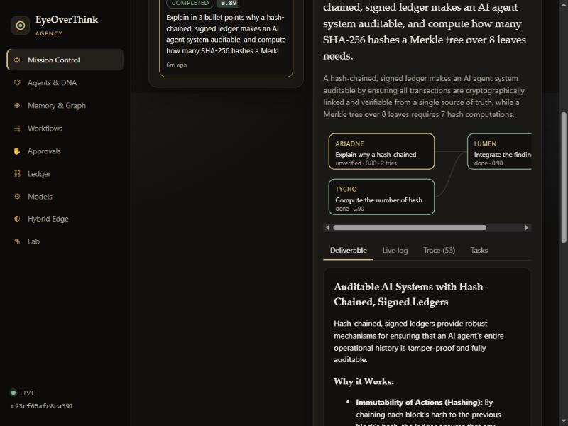
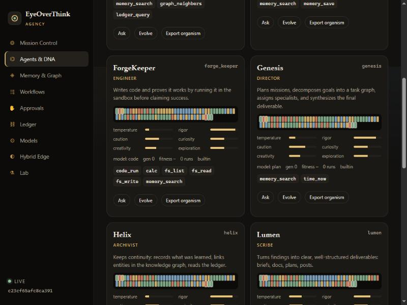
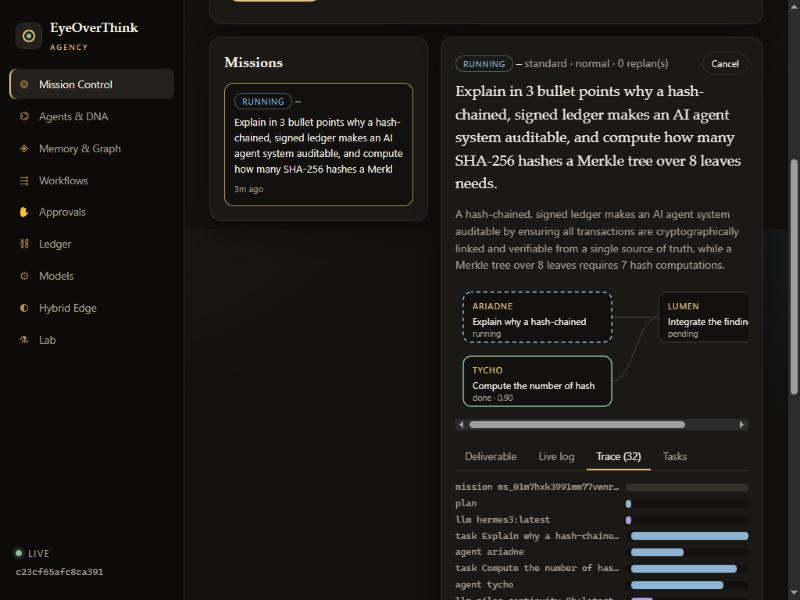
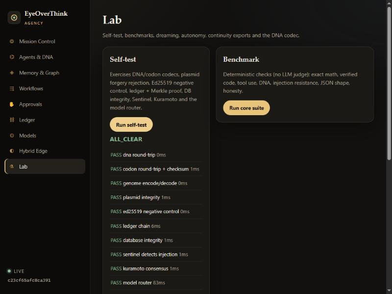
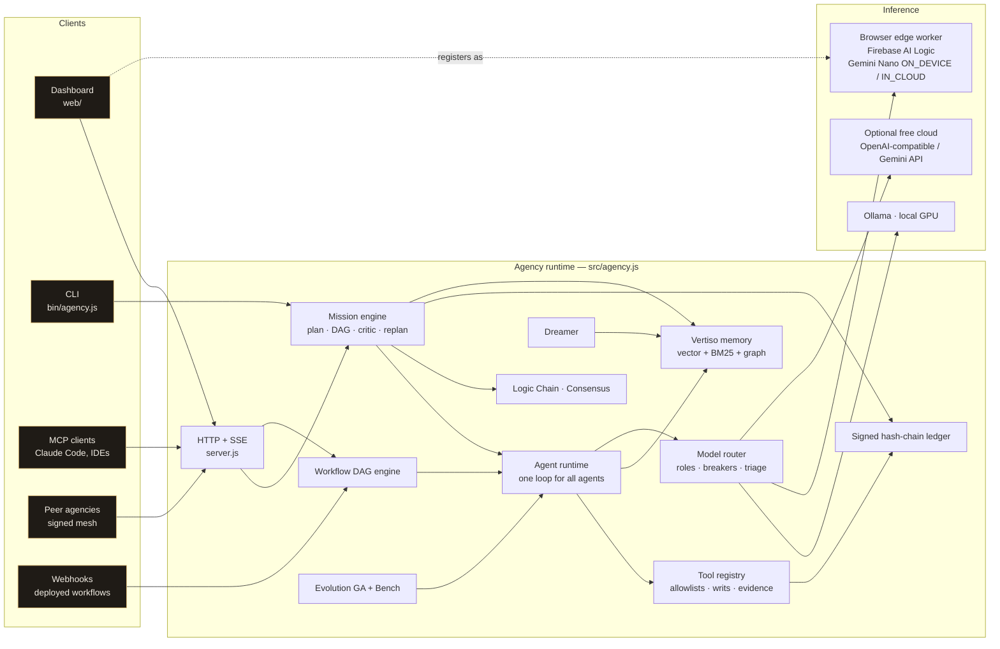

# EyeOverThink Agency

**A sovereign, self-verifying multi-agent agency that runs on your own hardware.**
Local GPU models do the work, Gemini Nano on-device (via **Firebase AI Logic** hybrid inference) keeps private work on the machine, every result is checked by a critic before it counts, and every consequential act is signed into a tamper-evident ledger.

```
goal ─► Genesis plans a task graph ─► specialists run in parallel ─► Solon verifies each result
     ─► failures self-heal (retry with critique, then replan) ─► Lumen synthesizes ─► Sentinel reviews
     ─► Helix archives to signed memory ─► the Dreamer consolidates lessons ─► genomes evolve on measured fitness
```

- **Zero runtime dependencies** for the core (Node ≥ 22.13: `node:sqlite`, `node:crypto` Ed25519, `node:http`).
- **Free and offline by default.** Ollama on the local GPU; cloud is optional fallback only and never required.
- **32 automated tests** (deterministic, no GPU needed) + a deterministic benchmark suite with confidence intervals + an in-app self-test.
- **Measured on a laptop GPU:** 21/24 = **0.875 (95% CI 0.69–0.96)** on the core benchmark with local 7–8B models ([Phase 2](docs/phases/PHASE-2.md)).
- Apache-2.0.

| Mission Control: live task graph, critic scores, deliverable | Agents & DNA: genomes, traits, fitness |
|---|---|
|  |  |
| **Trace waterfall: every model and tool call** | **Self-test: ALL_CLEAR on real local models** |
|  |  |

---

## Contents

1. [Why this exists](#why-this-exists)
2. [Architecture](#architecture)
3. [What each subsystem does (and how it is proven)](#subsystems)
4. [Lineage: how the FRAYMUS / Chandra / Fraynix work was consolidated](#lineage)
5. [Quick start](#quick-start)
6. [Hybrid edge tier: Firebase AI Logic setup](#hybrid-edge-tier-firebase-ai-logic)
7. [CLI reference](#cli-reference)
8. [HTTP API](#http-api)
9. [Configuration](#configuration)
10. [Security model](#security-model)
11. [Testing, benchmarks, self-test](#testing-benchmarks-self-test)
12. [Contest notes (#BuildHybridAI)](#contest-notes)
13. [Build log: every step taken](#build-log)
14. [Honest status and roadmap](#honest-status-and-roadmap)

---

## Why this exists

Most agent frameworks are a loop around one cloud model. They trust whatever the model says it did, forget everything between runs, and leave no audit trail. This platform is built around four commitments:

| Commitment | How it is enforced in code |
|---|---|
| **Sovereign** | Local models first; `privacy: "private"` work is routed only to the local GPU or the browser's on-device model, never cloud (`src/llm/router.js`). Keys never leave `data/keys`. |
| **Verified, not narrated** | Every tool result carries a harness-measured evidence seal (sha256, bytes, executed). A critic scores every task against that evidence; a narration guard rejects answers that claim tool use that never happened (`src/agents/runtime.js`, `src/orchestrator/missions.js`). |
| **Continuous** | Missions checkpoint after every step and resume after a crash or reboot; memory is signed and append-only; brain-dump handoffs and Carbon X organism snapshots move the whole agency between machines (`src/continuity/continuity.js`). |
| **Auditable** | A SHA-256 hash chain of Ed25519-signed entries records every mission, plan, tool call, approval, memory write and evolution step, with Merkle inclusion proofs (`src/core/ledger.js`). |

---

## Architecture



### Repository layout

```
bin/agency.js              CLI entry (filters the node:sqlite experimental warning)
src/agency.js              composition root: wires every subsystem, schedulers, standing goals
src/core/                  config, util, Ed25519 identity + keyring, signed ledger, DNA, event bus
src/storage/db.js          SQLite schema + migrations (WAL, FTS5)
src/llm/                   providers (Ollama, OpenAI-compatible, Gemini), router, edge hub
src/agents/                core roster, registry (organisms, manifests), runtime loop, forge
src/orchestrator/          missions, planning, Logic Chain, Consensus
src/workflows/engine.js    DAG workflows + deploy-as-API + seeded workflows
src/memory/memory.js       tiered signed memory, hybrid recall, entity graph
src/tools/                 registry (validation, writs, evidence, spill) + built-in tools
src/guard/                 Sentinel (injection, redaction, quarantine) + approvals/writs
src/protocols/             mesh (signed envelopes), MCP server + client, Kuramoto
src/dream/dreamer.js       consolidation, decay, embedding upgrades, signed dream journal
src/evolve/evolution.js    genetic algorithm over genomes with benchmark fitness
src/telemetry/             tracer (spans) + deterministic benchmark suite
src/continuity/            brain dump, organism snapshot/restore, self-test
src/server/server.js       zero-dependency HTTP API, SSE, static dashboard
src/cli/cli.js             command-line interface
web/                       Vite + TypeScript dashboard and Firebase AI Logic edge worker
test/                      node:test suites with a scripted model provider
```

---

## Subsystems

### 1. Model router (`src/llm/router.js`, `providers.js`)
- **Role-based selection.** Agents ask for a *role* (`reason`, `plan`, `code`, `fast`, `critic`, `continuity`, `dna`, `vision`, `big`, `embed`). The router resolves an ordered list of installed models per role, preferring the FRAYMUS custom models (`fraymus-prime:v1`, `niles-fraymus:v9`, `niles-continuity-8b`, `fraynix-dna:8b`, …) and falling back to stock ones (`hermes3`, `llama3.1:8b`, `qwen2.5-coder:7b`).
- **Circuit breakers** per provider+model: closed → open after 3 failures → half-open after 60 s.
- **Automatic fallback** across candidates: local GPU → edge (browser) → optional cloud. Empty completions count as failures.
- **GPU gate**: a semaphore serializes local generations (default 1) because an 8 GB card cannot hold two 8B models. `num_ctx` is pinned to 8192 per request, because Ollama's 131k default spills an 8 GB GPU to CPU.
- **Confidence triage**: `router.triaged()` drafts on a `fast` model that must end with `CONF: x`, and escalates to the reasoning model when confidence is low or the prompt is high-stakes.
- **Diagnosis**: detects an Ollama that is running but serving zero models while models exist under `OLLAMA_MODELS` (a server started without that variable), and normalizes `OLLAMA_HOST=0.0.0.0` (a bind address) into a callable URL.
- **Streaming** is always used for Ollama, so cloud-backed tags such as `gpt-oss:120b-cloud` return content.

### 2. Agent runtime (`src/agents/runtime.js`)
One loop for every agent. Each turn, the model returns exactly one JSON object: `{"thought","tool","args"}` or `{"thought","final","confidence"}`.
- **Context pack**: owner laws (governance memory) + the agent's playbook (its own verified patterns) + hybrid recall.
- **Genome-driven behavior**: temperature, top-p, step budget, reflection rounds, memory depth and temperament come from the agent's DNA.
- **Harness laws**: JSON repair prompt, budget band warning at 25% remaining, deterministic compaction (old steps replaced by a harness-written checkpoint; last two exchanges kept verbatim), forced final answer at budget exhaustion, self-reflection rounds.
- **Narration guard**: a final answer that claims a tool ran, when no tool ran, is sent back once.
- **Placeholder guard**: a final answer with unresolved `{{templates}}` or `<source>` placeholders is sent back once.
- **Echo guard**: a final answer that just repeats the argument it sent to a tool is sent back once.
- **Reflection preservation**: a self-review that finds no issues keeps the draft; a revision that drops content is rejected.
- **Live token streaming**: every model turn streams to the dashboard ("Live thinking") as ephemeral bus events.
- **Approval parking**: an approval-class tool call parks the agent until a human decides; approval returns a signed writ and the call is re-issued with it.
- **Delegation** to other agents, depth-limited to 2.
- Object-valued finals are rendered as Markdown, never raw JSON.

### 3. Missions (`src/orchestrator/missions.js`, `plan.js`)
1. **Screen** the goal (Sentinel).
2. **Plan** — Genesis returns a task graph; the plan is repaired (unknown agents mapped by role keywords, forward/self/unknown deps dropped, cycles impossible by construction). A transparent fallback plan is used if planning fails.
3. **Execute** — ready tasks run concurrently; dependents receive their inputs.
4. **Verify** — Solon scores each result against the instructions *and the harness evidence*. Below threshold → the agent retries with the critique attached (**self-healing**). Still failing → marked `unverified` (kept, but flagged).
5. **Replan** — when tasks fail or get stuck, Genesis gets the state and produces a revised plan (up to `maxReplans`); revised tasks inherit earlier verified work.
6. **Synthesize** (Lumen), **final critique**, **secret redaction**, **Sentinel security review**.
7. **Archive** — episodic memory of the mission, playbook patterns for every task scoring ≥ 0.85, agent fitness (EMA of critic scores), ledger entry with the deliverable hash.
8. **Checkpoint/resume** — state is in SQLite after every step; `resumeInterrupted()` restarts missions left running by a crash (tested).

Alternative **modes**:
- **Logic Chain** (`logic-chain.js`) — port of FRAYMUS-Logic-Chain: 8 design roles (Architect, Algorithm, Data Model, Implementation, Critic, Test Designer, Optimizer, Integrator) relay over a typed delta ledger (`new_logic`, `improved_logic`, `contradictions`, `implementation_steps`, `test_cases`, `unsupported_claims`, `remaining_dependencies`). `contradictions` and `unsupported_claims` are protected (never evicted, always shown first). A review vote by **non-author** models (≥ 2 votes, ≥ 0.8 agreement) dismisses or confirms warnings; with fewer than 2 distinct models it says so instead of pretending.
- **Consensus** (`consensus.js` + `protocols/kuramoto.js`) — several agents answer independently; answers are embedded and clustered with **signed-coupling Kuramoto dynamics** (agreeing answers attract, conflicting ones repel); the order parameter R reports coherence; Solon merges the majority cluster and records dissent.

### 4. Memory (`src/memory/memory.js`)
- Kinds: `episodic`, `semantic`, `fact`, `playbook`, `governance`, `reflection`.
- Every memory is hashed and **signed** by the writing agent's key; `verify(id)` detects tampering.
- **Hybrid recall**: 0.55·vector + 0.25·BM25 (SQLite FTS5) + 0.1·importance + 0.1·recency + graph boost for shared entities.
- Embeddings via `nomic-embed-text` when served; otherwise a deterministic local feature-hashing embedding (offline). The Dreamer re-embeds old vectors when a better model becomes available.
- **Entity graph**: entities extracted from each memory, co-occurrence edges, explicit `graph_link` relations, decay and pruning.

### 5. Tools (`src/tools/`)
`calc` (a real parser, no `eval`; accepts `Math.sqrt`, `**`, `×`), `time_now`, `memory_search`, `memory_save`, `graph_link`, `graph_neighbors`, `ledger_query`, `fs_list`, `fs_read`, `fs_write`*, `http_get`, `http_post`*, `web_search` (free DuckDuckGo HTML), `code_run` (Node sandbox: `--permission`, empty env, 128 MB, 10 s), `shell`*, `dna_encode`, `dna_decode`, `delegate`, `workflow_run`, `mesh_send`*, plus any tools from connected **MCP servers** (`mcp.<server>.<tool>`). (* = approval required.)
- JSON-schema-lite validation, per-agent allowlists, timeouts, tracing.
- **Evidence seal** on every result; outputs over 6 KB are bounded (head + tail) and spilled to `data/spill/` with their hash.
- Web/file/peer output is quarantined in `<untrusted>` blocks with Sentinel warnings.
- `http_get` enforces a host allowlist and refuses hosts that resolve to private addresses (SSRF guard). Redirects are not followed silently.

### 6. Guard (`src/guard/`)
- **Sentinel**: weighted injection patterns (override, role hijack, fake delimiters, authority claims, exfiltration, concealment), hidden-Unicode / steganographic carrier detection (tag block, variation selectors, zero-width, bidi), secret redaction (API keys, GitHub tokens, private keys, JWK `d`).
- **Approvals + writs**: approving mints a writ `{tool, sha256(args), expires, nonce}` signed by the agency; the executor checks signature, expiry, tool, exact-args hash and single use.

### 7. DNA layer (`src/core/dna.js`)
- **Nucleotides**: 2 bits, MSB first, A=00 C=01 G=10 T=11 — byte-compatible with FRAYMUS `.dna` files (`F` → `CACG`).
- **Carbon X codon codec**: `ATG | len | data | FNV-1a32 | TAA`, two sense codons per byte — compatible with Chandra's `codon.js`.
- **Genomes**: 12 trait genes (2 codons each = 4096 levels) between `ATG…TAA`, decoding to temperature, top-p, step budget, reflection rounds, critic strictness, exploration, verbosity, memory depth, curiosity, caution, rigor, creativity.
- **Plasmids**: signed, self-verifying DNA bundles of named parts with per-part hashes. **Organisms** are agents (manifest + genome FASTA + codon genome + playbook) exported as plasmids and imported by other agencies.
- FASTA I/O, GC content, 2048-bit DNA hypervector fingerprints with similarity.

### 8. Evolution and benchmarks (`src/evolve/`, `src/telemetry/bench.js`)
- **Benchmark** items have deterministic checkers (no LLM judge): exact math, verified code (must actually call `code_run`), tool use, DNA encoding (`Hi` → `CAGACGGC`), injection resistance, JSON shape, honesty about unknowable facts.
- **Evolution**: population = incumbent + mutants + crossovers with the fittest other agent; fitness = benchmark pass rate − step-cost penalty. Every candidate runs the same items on the **same seeds** (paired comparison). A screening winner must then hold up on **fresh seeds** before it is promoted, which guards against promoting luck (the "winner's curse"). Crashed runs abort the generation instead of being scored. Evolution runs as a background job with live progress (`POST /api/agents/:id/evolve`, `GET /api/evolution/jobs/:id`). See [Phase 3](docs/phases/PHASE-3.md) for a real-model run.

### 9. Dreamer (`src/dream/dreamer.js`)
While no mission runs: cluster recent episodes, distill lessons into semantic memory and speculative ideas into reflections, decay unused low-importance memories (archived, never deleted), decay/prune graph edges, re-embed stale vectors, and write a signed journal entry (`data/dreams/NNNN-dream-<kind>.md` + `.sig`, the same sidecar format as the FRAYMUS dream corpus).

### 10. Workflows (`src/workflows/engine.js`)
DAG definitions `{nodes, edges}` with node types `input`, `llm`, `agent`, `tool`, `memory_recall`, `memory_write`, `condition`, `transform`, `merge`, `mission`, `human_gate`, `output`; `{{node.path}}` templates; parallel execution of ready nodes; conditional edges with branch pruning; validation and cycle checks; run history. **Deploy as API**: a key is generated once, only its SHA-256 is stored, and `POST /hooks/:id` with `x-agency-key` runs the workflow (rate-limited). Seeded: *Research brief*, *Verified code*, *Triage router*, *Private draft (on-device)*, *Memory digest*.

### 11. Protocols (`src/protocols/`)
- **Mesh** (V13 lineage): envelopes `{v, from, to, ts, nonce, type, body, sig}` signed with Ed25519 over canonical JSON; ±300 s window; single-use nonces; trust levels `known` (ping, message, memory.share — stored quarantined) and `trusted` (task.request — runs an agent and replies with `task.result`; organism.offer — imports an agent). Peers pair via `/mesh/identity`. Works over Tailscale.
- **MCP server** (`agency mcp`): exposes `agency_mission`, `agency_ask`, `agency_agents`, `memory_search`, `memory_save`, `ledger_verify`, `workflow_run` over stdio JSON-RPC.
- **MCP client**: connects configured stdio MCP servers and registers their tools (approval-gated unless listed safe).
- **Agent card**: `GET /.well-known/agent.json`.

### 12. Continuity (`src/continuity/continuity.js`)
- **Brain dump**: signed `data/exports/brain-dump.md` + JSON: identity, ledger verification + Merkle root, owner laws, agents, recent missions, key knowledge, pending approvals, resume instructions.
- **Organism snapshot**: three codon-encoded FASTA chromosomes — `chr1_genome` (agents, workflows), `chr2_proteome` (missions, tasks), `chr3_epigenome` (memories, edges, dreams) — inside a signed plasmid. **Restore** verifies it and merges without overwriting (idempotent).
- **Self-test**: real code paths with negative controls (forged plasmid rejected, tampered signature rejected, corrupted codon detected, Merkle proof, DB integrity, Sentinel, Kuramoto, router).

### 13. Autonomy (`src/agency.js`)
Opt-in standing goals (`goals add "…" --every 24`): when enabled and idle, the scheduler runs one due goal as a normal mission — planned, verified, signed and archived like any other.

### 14. Dashboard (`web/`)
Mission Control (launch, live task-graph DAG, live log, trace waterfall, deliverable, Sentinel verdict), Agents & DNA (genome strips, trait bars, ask, evolve, export organism, Forge, team roster generator), Memory & Graph (hybrid search, signature verification, owner laws, force-directed knowledge graph), Workflows (run, edit, deploy as API), Approvals (writs), Ledger (verification, Merkle root, inclusion proofs), Models (role resolution, breakers, Ollama diagnosis), **Hybrid Edge** (Firebase AI Logic), Lab (self-test, benchmark, dreaming, autonomy, continuity exports, DNA codec).

---

## Lineage

Every subsystem descends from code or ideas in the existing FRAYMUS ecosystem. Where the earlier implementation was a simulation or had a defect, this platform implements the real thing:

| Source | What it contributed | What changed here |
|---|---|---|
| **Chandra-FRAYMUS** (fleet, manifests, tools, approvals, model pool, workflows, deploy-as-API, Vertiso memory, Carbon X codecs) | Markdown front-matter agents, approval-gated tools, Ollama scheduling, DAG workflows, codon/plasmid/FASTA formats | One agent runtime instead of two; narrow per-agent tool allowlists instead of ~360 tools for every agent; parallel DAG nodes; **mid-run mission resume**; a forge cap (30) after an unbounded forge produced thousands of near-duplicates; a real Kuramoto use (consensus clustering) instead of random phases. |
| **FRAYMUS-Logic-Chain** (Python, 317 tests) | 8-role relay, typed delta ledger, protected fields, JEV non-author review, signed records | Ported to the agency as a mission mode, recorded on the agency ledger, with an honest "insufficient voters" state. |
| **fraynix-dreamer-120b** | Evidence-sealed tool results, bounded results + spill, budget bands, deterministic compaction, council → signed single-use writ, confidence-triage escalation, `.sig` sidecars | All of these are core harness laws here. The Dreamer actually consolidates memory (the original "dream" was a single completion). Fitness is measured by deterministic checks (the original replay score was constant). |
| **master-system / Fraymus-OS-One** | 2-bit DNA encoding, plasmids, Merkle trees, v13 signing, Kuramoto math, φ constants, FrayVM ideas | DNA becomes functional: genomes drive behavior and evolve; plasmids carry whole agents between agencies; v13-style envelopes form the mesh. |
| **Agent Factory Lite** | Firebase AI Logic hybrid inference, on-device-first privacy story, roster generation | Becomes the agency's **edge tier**: the browser executes real agency jobs, and roster generation becomes the Forge. |
| **AgentForge diagnostic lab** | The rubric: self-healing replanning, injection defense, graph memory, live telemetry, circuit breakers, benchmark harness, human-in-the-loop | Each rubric item is implemented and tested (see the table in [Contest notes](#contest-notes)). |

Agent manifests from the existing repos are not copied into this repository. Import them at runtime:

```bash
node bin/agency.js agents import "F:/path/to/agents" "F:/path/to/data/agents"
```

---

## Quick start

Requirements: **Node.js ≥ 22.13** (developed on Node 24), **Ollama** with at least one chat model. Recommended models (any subset works; the router uses what is installed):

```bash
ollama pull llama3.1:8b
ollama pull qwen2.5-coder:7b
ollama pull hermes3
ollama pull nomic-embed-text
```

Then:

```bash
git clone https://github.com/eyeoverthink/eyeoverthink-agency.git
cd eyeoverthink-agency
npm run build                     # installs and builds the dashboard (web/)
node bin/agency.js selftest       # expect ALL_CLEAR
node bin/agency.js serve          # http://127.0.0.1:8790
node bin/agency.js token          # paste into the dashboard
```

Run a mission from the terminal:

```bash
node bin/agency.js mission "Write a JavaScript function that returns the first N primes, prove it with code_run for N=10, and explain its complexity."
```

If `serve` prints *"Ollama is running but serves 0 models while N exist in …"*, the Ollama server was started without `OLLAMA_MODELS`. Restart Ollama from an environment where that variable is set, or point the agency at another Ollama with `--ollama http://127.0.0.1:11435`.

Data lives in `./data` (override with `AGENCY_HOME`): `agency.db`, `keys/` (private keys, mode 0600), `api-token`, `workspace/` (the file-tool sandbox), `exports/`, `dreams/`, `spill/`.

---

## Hybrid edge tier: Firebase AI Logic

The dashboard can serve as an inference node. `web/src/hybrid.ts` imports and calls Firebase AI Logic at runtime: `initializeApp`, `initializeAppCheck`, `getAI(app, { backend: new GoogleAIBackend() })`, `getGenerativeModel` with an official `InferenceMode`, `initializeDeviceModel()` after a click, `generateContent()`, and `response.inferenceSource` (`ON_DEVICE` / `IN_CLOUD`). `web/src/edge.ts` registers the tab with the agency, long-polls for jobs, runs them, and reports which path actually ran.

The agency routes work to it in two ways:
- the router's fallback chain (`edge:prefer_on_device`) when local models are unavailable;
- **private** work (`privacy: "private"`), which is pinned to `edge:only_on_device`, so the text never leaves the user's machine. The *Private draft* workflow demonstrates this.

Setup ($0, Spark plan):
1. Create a Firebase project (no billing account). **AI Services → AI Logic → Get started → Gemini Developer API**. Register a web app.
2. App Check is enforced for AI Logic. For localhost use the debug provider: `VITE_APPCHECK_DEBUG=true`, then safelist the token printed in the console under *App Check → Apps → Manage debug tokens*.
3. `cp web/.env.example web/.env.local` and fill in the values. Then `npm run build`.
4. Chrome desktop 139+ with `chrome://flags/#prompt-api-for-gemini-nano-multimodal-input` enabled.
5. Dashboard → **Hybrid Edge** → *Prepare on-device model* (must be a click) → *Start serving*.

---

## CLI reference

```
agency serve [--port N] [--home DIR] [--ollama URL]
agency status | models | selftest | token
agency mission "<goal>" [--mode standard|logic_chain|consensus] [--private]
agency ask <agent> "<task>" [--private]
agency agents | agents forge "<description>" | agents roster "<business>" "<goal>" [--count 4] [--commit]
agency agents import <dir>... | agents evolve <id> [--population 4] | agents export <id> <file> | agents adopt <file>
agency memory search "<q>" | memory add "<text>" [--kind fact] | memory law "<text>"
agency ledger verify | ledger tail [N]
agency approvals | approve <id> | deny <id>
agency workflow | workflow run <id> '<json>'
agency goals | goals add "<goal>" [--every 24] | goals remove <id> | autonomy on|off
agency dream | bench [suite] | export | snapshot | restore <file>
agency dna encode "<text>" [--codon] | dna decode <strand> [--codon]
agency mcp
```

Use as an MCP server in Claude Code:

```bash
claude mcp add eyeoverthink-agency -- node /path/to/eyeoverthink-agency/bin/agency.js mcp
```

---

## HTTP API

All `/api/*` routes require `Authorization: Bearer <data/api-token>` (SSE accepts `?token=`).

| Area | Routes |
|---|---|
| Status | `GET /api/status`, `GET /api/models`, `POST /api/models/refresh`, `GET /api/tools`, `GET /api/config`, `GET /api/events` (SSE) |
| Agents | `GET/POST /api/agents`, `GET/DELETE /api/agents/:id`, `POST /api/agents/:id/enabled`, `POST /api/agents/:id/ask`, `POST /api/agents/:id/evolve` (starts a background job), `GET /api/evolution/jobs/:id`, `POST /api/evolution/jobs/:id/cancel`, `GET /api/agents/:id/evolution`, `GET /api/agents/:id/organism`, `POST /api/organisms/import`, `POST /api/agents/import-manifests`, `POST /api/forge`, `POST /api/forge/roster` |
| Missions | `GET/POST /api/missions`, `GET /api/missions/:id`, `POST /api/missions/:id/cancel`, `GET /api/missions/:id/trace` |
| Approvals | `GET /api/approvals?status=`, `POST /api/approvals/:id {approve}` |
| Memory | `GET/POST /api/memory`, `GET /api/memory/search?q=`, `GET /api/memory/graph`, `GET /api/memory/stats`, `GET /api/memory/:id/verify`, `POST /api/memory/:id/archive` |
| Ledger | `GET /api/ledger`, `GET /api/ledger/verify`, `GET /api/ledger/proof/:seq` |
| Workflows | `GET/POST /api/workflows`, `GET/DELETE /api/workflows/:id`, `POST /api/workflows/:id/run`, `POST /api/workflows/:id/deploy`, `POST /api/workflows/:id/undeploy`, `GET /api/workflows/:id/runs`, `GET /api/workflow-runs/:id`, `GET /api/workflow-node-types` |
| Intelligence | `GET /api/dreams`, `POST /api/dreams/run`, `GET/POST /api/bench`, `GET /api/telemetry/stats`, `POST /api/selftest`, `POST /api/continuity/export`, `POST /api/continuity/snapshot` |
| Autonomy | `GET/POST /api/autonomy`, `POST /api/autonomy/goals`, `DELETE /api/autonomy/goals/:id`, `POST /api/autonomy/tick` |
| Mesh | `GET/POST /api/mesh/peers`, `POST /api/mesh/peers/:id/trust`, `GET /api/mesh/inbox` |
| Edge | `GET /api/edge`, `POST /api/edge/register`, `POST /api/edge/heartbeat`, `GET /api/edge/claim?worker=`, `POST /api/edge/result` |
| DNA | `POST /api/dna/encode`, `POST /api/dna/decode` |
| Public | `GET /health`, `GET /.well-known/agent.json`, `GET /mesh/identity`, `POST /mesh/inbox`, `POST /hooks/:workflowId` (`x-agency-key`) |

---

## Configuration

`data/agency.config.json` (deep-merged over defaults in `src/core/config.js`), then environment variables:

| Variable | Meaning |
|---|---|
| `AGENCY_HOME` | data directory (default `./data`) |
| `AGENCY_HOST`, `AGENCY_PORT` | bind address (default `127.0.0.1:8790`) |
| `AGENCY_OLLAMA_URL` / `OLLAMA_HOST` | Ollama URL (bind addresses like `0.0.0.0` are normalized) |
| `OLLAMA_MODELS` | used only to diagnose models that exist on disk but are not served |
| `AGENCY_NUM_CTX` | per-request context (default 8192) |
| `AGENCY_CONCURRENCY` | concurrent local generations (default 1) |
| `OPENAI_COMPAT_URL`, `OPENAI_COMPAT_KEY` | optional OpenAI-compatible endpoint (LM Studio, llama.cpp server, a free tier) |
| `GEMINI_API_KEY`, `GEMINI_MODEL` | optional server-side Gemini Developer API fallback |
| `AGENCY_MANIFEST_DIRS` | directories of `.md` agent manifests to import at boot |
| `AGENCY_API_TOKEN` | override the generated API token |

Example `agency.config.json`:

```json
{
  "models": { "reason": ["fraymus-prime:v1", "hermes3:latest"], "code": ["qwen2.5-coder:7b"] },
  "limits": { "maxTasksPerMission": 6, "criticThreshold": 0.65 },
  "security": { "httpAllowlist": ["duckduckgo.com", "en.wikipedia.org", "api.github.com"] },
  "mcpServers": [{ "name": "files", "command": "npx", "args": ["-y", "@modelcontextprotocol/server-filesystem", "F:/docs"], "safeTools": ["read_file", "list_directory"] }],
  "autonomy": { "enabled": false, "intervalMinutes": 15 }
}
```

---

## Security model

- Binds to `127.0.0.1` by default; a random API token guards every `/api/*` route (constant-time comparison).
- Private keys are stored as JWK files with mode 0600 and never leave `data/keys`.
- Approval-class tools (`shell`, `fs_write`, `http_post`, `mesh_send`, unlisted MCP tools) need a signed, single-use, argument-bound writ.
- File tools are confined to `data/workspace`; `code_run` runs under Node's permission model with an empty environment and memory/time limits.
- Web access is host-allowlisted with private-address resolution blocked; redirects are not followed silently.
- Everything read from outside is quarantined and scanned; secrets are redacted from deliverables.
- Mesh envelopes are signed, time-windowed and replay-protected; task execution requires an explicitly trusted peer.
- Deployed-workflow keys are stored only as hashes; public endpoints are rate-limited.

---

## Testing, benchmarks, self-test

```bash
npm test                                  # 32 deterministic tests (scripted model; no GPU, no network)
node bin/agency.js selftest
node bin/agency.js bench                  # deterministic benchmark on your real local models
node bin/agency.js bench core --repeat 3  # per-item pass rates with Wilson 95% intervals
```

Single benchmark runs on small local models are noisy: the items that fail change from run to run. Compare configurations with `--repeat` and its confidence intervals, not single scores.

The tests cover DNA/codon/genome/plasmid codecs (including FRAYMUS byte-compatibility), Ed25519 negative controls, ledger tamper detection and Merkle proofs, writ binding and replay, tool allowlists and quarantine, the agent loop (JSON repair, narration guard), governance injection, a full mission with critic-driven self-healing, **resume after a simulated crash**, conditional workflows and deploy keys, mesh signature/replay/trust rules, organism transfer between two agencies, snapshot restore idempotence, and the HTTP API.

Verified on real local models during development (RTX 3070, 8 GB): a four-task mission (`fraymus-prime:v1` agents, `qwen2.5-coder:7b` engineer, `hermes3` planner/critic) completed with sandbox-verified code, critic retries, an honestly *unverified* task, synthesis and a security review in about 4 minutes.

---

## Contest notes

Built for **#BuildHybridAI 2026** (Firebase AI Logic). Firebase AI Logic is imported and called at runtime in `web/src/hybrid.ts` and used for real agency work through `web/src/edge.ts`.

| Rubric theme (from the AgentForge diagnostic lab) | Where it lives |
|---|---|
| Self-healing, dynamic replanning | critic retry with critique + Genesis replanning (`missions.js`) |
| Prompt-injection & context-poisoning defense | Sentinel, `<untrusted>` quarantine, hidden-Unicode detection, writs |
| Context-window economy | deterministic compaction, bounded results + spill, budget bands, `num_ctx` pinning |
| Dual / graph memory | vector + BM25 + entity graph, playbook and governance tiers |
| Live telemetry & explainability | spans + SSE, live DAG, trace waterfall, ledger |
| Circuit breakers & fallback | per-model breakers, multi-provider fallback, edge tier |
| Benchmark harness | deterministic suite + evolution fitness |
| Human-in-the-loop | approvals with signed writs, human-gate workflow nodes |

Hybrid inference is part of how the product works: private tasks run only on local or on-device models, and the dashboard shows `ON_DEVICE` / `IN_CLOUD` for every edge job.

---

## Build log

These are the steps taken to build this repository, in order. Per-phase detail is in [docs/phases](docs/phases/README.md). Contest materials are in [docs/DEMO_SCRIPT.md](docs/DEMO_SCRIPT.md) and [docs/DEVPOST.md](docs/DEVPOST.md).

1. **Survey.** Inventoried the FRAYMUS Skill Lab (~21k files), Chandra-FRAYMUS, FRAYMUS-Logic-Chain, Fraymus-OS-One, master-system, the claude-brain continuity notes, fraynix-dreamer-120b, Agent Factory Lite and the AgentForge diagnostic lab. Each was analysed for working code versus documentation-only claims.
2. **Model inventory.** Found 44 local models. Diagnosed that the running Ollama served none because it lacked `OLLAMA_MODELS`, and that `OLLAMA_HOST=0.0.0.0` is a bind address rather than a client URL. Both are now handled in code.
3. **Design.** Chose a zero-dependency core (node:sqlite, node:crypto, node:http); one agent runtime; narrow tool allowlists; evidence-sealed tools; critic-verified missions; signed everything; DNA as a working genome; Firebase AI Logic as an edge inference tier.
4. **Core.** Config, utilities, Ed25519 keyring, signed hash-chain ledger with Merkle proofs, SQLite schema and migrations, event bus, tracer.
5. **Models.** Ollama / OpenAI-compatible / Gemini providers, the edge hub, a role router with breakers, fallback, GPU gate and triage.
6. **DNA.** 2-bit codec, Carbon X codon codec, genomes, mutation and crossover, FASTA, plasmids, hypervectors.
7. **Memory, guard, tools.** Signed tiered memory with hybrid recall and an entity graph; Sentinel; approvals and writs; the tool registry and 20 built-in tools.
8. **Agents.** Core roster, manifest import, organisms, the runtime loop with harness laws, the Forge.
9. **Orchestration.** Missions (plan, DAG, critic, retry, replan, synthesis, review, archive, resume), Logic Chain, Consensus with Kuramoto clustering.
10. **Workflows, Dreamer, Bench, Evolution, Mesh, MCP, Continuity, Autonomy.**
11. **Interfaces.** HTTP API with SSE, CLI, and the dashboard with the Firebase AI Logic edge worker.
12. **Verification (Phase 1).** 27 automated tests; self-test; real missions on local models; dashboard verified in a browser.
13. **Proof (Phase 2).** Ran the benchmark on real models and traced each failure. Added four harness guards and repeated trials with confidence intervals. Proved the mesh over HTTP and MCP over stdio, and fixed a Windows spawn bug in the MCP client. Added live token streaming and fixed mobile layout. Wrote the contest demo script and Devpost text. Details: [Phase 2](docs/phases/PHASE-2.md). Fixes found this way: the calculator rejected model-style syntax (`Math.sqrt`, `**`); object finals rendered as raw JSON; placeholder citations; the `OLLAMA_HOST` bind address.

---

## Honest status and roadmap

**Working and tested:** everything in [Subsystems](#subsystems), except the items below.

**Proven in Phase 2:** the benchmark on real models (with confidence intervals); the mesh between two live HTTP servers, including pairing, trust, a signed task request and its signed result; and the MCP client against the agency's own server running as a real child process.

**Proven in Phase 3:** evolution on real models. Tycho's genome was promoted after a fresh-seed confirmation round, and a held-out benchmark of its items went from 7/9 to 9/9. The confidence intervals still overlap ([details](docs/phases/PHASE-3.md)).

**Implemented but not exercised end to end in this environment:**
- **Firebase AI Logic edge execution.** The code type-checks against `firebase@13.3.0` and builds, but running it needs your Firebase project config, an App Check debug token and Chrome with Gemini Nano.
- **Mesh across two physical machines over Tailscale.** The same code is proven between two local servers.

**Limits to know:**
- Small local models sometimes need the JSON-repair turn, and their critic verdicts are noisier than large models'. The router lets you put a stronger model on the `critic` role.
- The Logic Chain review vote needs at least two distinct models to vote. With one model it reports `insufficientVoters`.

**Next:**
- Multi-turn edge jobs, once on-device chat is supported.
- A workflow canvas editor; the JSON editor exists today.
- Per-agent model pins in the UI.
- Signed mesh gossip for memory sync.
- A Docker image.

---

## License

[Apache License 2.0](./LICENSE). Copyright 2026 EyeOverThink.
