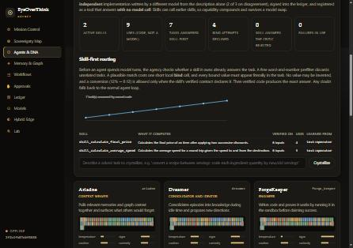

# Phase 10: Skill-first routing: use what the agency owns before renting a model

Previous: [Phase 9](PHASE-9.md) · [Index](README.md)

## The problem
Phase 9 gave the agency skills of its own: verified code learned from solved tasks that answers with no model call. But they were only *tools an agent might pick*. An agent still spent several model turns before (maybe) calling one, and usually it just did the arithmetic itself, sometimes wrongly. Owning a capability is worth little if the system doesn't reach for it.

## The idea
Before an agent spends any model turn, the agency asks one question: **does a skill it owns already answer this task?** Every step can only *decline*; nothing can force a route:
1. **Prefilter (free, no model).** Content-word overlap between the task and the skill's name, description, parameter names and parameter descriptions. The task must also state at least as many numbers as the skill has required numeric parameters. Unrelated tasks cost nothing.
2. **Bind (one short local call, role `fast`, privacy `private`).** Which skill's output *alone* fully answers the task, and with what input?
3. **Ground (free, no model).**
   - Every bound number and string must appear literally in the task, so no value can be invented.
   - A conversion (12% → 0.12) is allowed only when the skill's verified contract declares it (`decimal`/`fraction`) *and* the task states that percentage.
   - The schema's required keys and types must hold.
4. **Run the verified code** in the sandbox and return the exact result with its provenance (skill, code hash, input; the input is omitted for private and sealed work).

Any doubt at any step falls back to the normal agent loop, so trying costs at most one short call. The rules around it:
- **Seeded runs never route.** Evolution and benchmarks measure the agent's genome, not the library.
- **Missions:** only the first attempt routes. If the critic rejects a skill-routed answer, that is ledgered (`skill.route_rejected`) and the retry runs the full agent loop.
- **Synthesis** (combining teammates' work) never routes.

## Measured on real models (A/B, same tasks, skill-first off vs on)
Agent `tycho`, binder `llama3.2` (3B), home with the two Phase 9 skills.
- Matching tasks were *paraphrased*, not the original wording.
- Controls were built to **tempt a wrong route**:
  - a plain distance-over-time speed, where the harmonic-mean skill would be wrong;
  - a discount *amount*, where the final-price skill would be wrong;
  - a product blurb that mentions a price.

**Run 2** (after the fix below), [evidence](evidence-phase10-ab-run2.json):

| Task | Off: calls / tokens / s / correct | On: calls / tokens / s / correct |
|---|---|---|
| Jacket, 12% then 8% off $120 | 4 / 4,051 / 7.2 / ✓ | **1 / 301 / 2.5 / ✓** (skill) |
| TV, 20% then 10% off $250 | 4 / 4,094 / 16.0 / ✓ | **1 / 298 / 3.6 / ✓** (skill) |
| Laptop, 15% then 5% off $899.99 | 4 / 4,124 / 16.5 / "$727" (rounded) | **1 / 305 / 3.7 / ✓ 726.741925** (skill) |
| Lake round trip, 40 / 60 mph | 5 / 6,059 / 23.5 / ✗ (said 50) | **1 / 260 / 3.7 / ✓ 48** (skill) |
| Bike round trip, 12 / 18 km/h | 5 / 6,386 / 29.4 / ✗ (**216 km/h**) | **1 / 259 / 3.6 / ✓ 14.4** (skill) |
| *Control:* train, 120 mi in 2 h | 9 / 9,222 / ✓ | 6 / 4,416 / ✓ (binder declined, so not routed) |
| *Control:* discount amount | 3 / 2,749 / ✓ | 3 / 2,743 / ✓ (prefilter: 2 numbers < 3) |
| *Control:* product blurb | 5 / 6,020 | 7 / 13,064 (not routed; agent variance) |

- **Matching tasks:**
  - **22 → 5 model calls**, **24,714 → 1,423 tokens** (−94%), **92.6 s → 17.0 s**;
  - **5 of 5 correct with skills**; the agent alone got 2 of 5 strictly right (3 if "$727" counts).
- **Misroutes:** **0 of 3** controls.
- **All eight tasks:** 39 → 21 calls, 42,705 → 21,646 tokens, 138 s → 64 s.
- Agent-only correctness varies between runs: run 1 got 3 of 5 matching tasks. Owned code doesn't vary.

**Run 1** found a real flaw, [evidence](evidence-phase10-ab-run1.json):
- The speed tasks routed (9 → 1 and 4 → 1 calls; the agent alone got the bike ride wrong).
- **No discount task routed.**
  - The ledger showed why: `discount1 = 0.12 does not appear in the task`.
  - The learned skill's own verified contract says *"discount rate as a decimal (e.g., 0.12 for 12%)"*. The binder followed it correctly, and the original "never convert" grounding rule rejected every correct binding.
  - The laptop task never reached the binder: the prefilter read parameter names but not their descriptions.
- **Fix:**
  - a conversion is allowed only when the skill's contract declares it and the task literally states the percentage;
  - the prefilter includes parameter descriptions.

  An undeclared conversion is still rejected (tested).

## Tests
93 pass. `test/skill-route.test.js` (6) covers:
- **Grounding:** invented, rescaled and undeclared-converted values are rejected; a declared percent-as-decimal is accepted only if the task states that percentage; `2026-11` reads as 11, not −11.
- **A matching task answered with one bind call** and no agent loop (exact result, ledgered route, curve).
- **An unrelated task costs zero model calls.**
- **A bad binding falls through** to the agent loop and is not held against the skill.
- **The binder declining, seeded runs and `skillFirst: false`** never route.
- **A mission where the critic rejects the skill answer:** ledgered, and the retry runs the full loop.

## Files
- **Changed:**
  - `src/evolve/crystallizer.js`: `route`, `answerText`, `words`, `groundingProblem`, and `stats()` gains routed, misses, rejected, a lower bound on calls avoided, and the curve.
  - `src/agents/runtime.js`: skill-first before the agent loop.
  - `src/orchestrator/missions.js`: first attempt only, `skill.route_rejected`, synthesis excluded.
  - `src/agency.js`: wiring.
  - `src/core/config.js`: `skills.first`, `bindRole`, `minOverlap`.
  - `web/src/main.ts` and `style.css`: routing stats and the cumulative curve.
- **New:**
  - `test/skill-route.test.js`;
  - evidence JSONs from both runs (harness at `F:\Claude-Work\eyeoverthink-agency\phase10-ab.mjs`).
- **New ledger kinds:** `skill.route`, `skill.route_miss`, `skill.route_rejected`.

## Patterns used
- **Cheapest check first.** A free structural filter (words and number count) runs before any model, so the common case of an unrelated task costs nothing.
- **Weak model, strong guard.** A 3B binder is allowed because grounding turns its worst failure (a plausible invented number) into a cheap fallback.
- **Contract-declared transformations.** Values are transformed only as the verified skill's own schema says.
- **Asymmetric failure costs.** A missed route costs one short call; a wrong route costs correctness. So every gate can only decline.
- **The critic stays in the loop.** Owned code is checked like any agent output, and rejections are evidence.

## What this enables next
- Retiring a skill on repeated `skill.route_rejected` or runtime failures (the data is now in the ledger).
- Learning bindings: the binder call is itself a candidate for crystallization (a deterministic parser per skill), which would take matching tasks to **zero** model calls.
- Carrying skills between agencies in organism plasmids.
