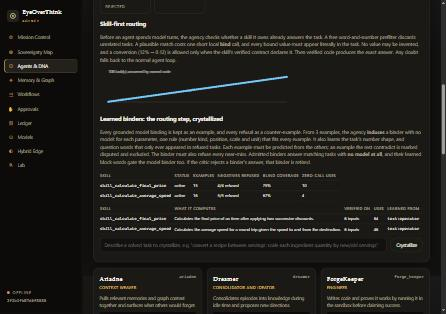

# Phase 11: Learned binders: zero-call routing, learned by induction

Previous: [Phase 10](PHASE-10.md) · Next: [Phase 12](PHASE-12.md) · [Index](README.md)

## The problem
Phase 10 routed matching tasks to owned skills, but every route still cost one model call: a short "bind" call that picks the skill and extracts its input. Binding is itself a repeated task with a pattern. If the agency can learn it, matching tasks need **no model at all**.

## What was built
- **Examples from the agency's own decisions.**
  - Every grounded model binding is stored as a positive example. Every binder refusal is stored as a negative for each candidate skill.
  - Private and sealed work never becomes an example.
  - A critic-rejected route turns its example into a negative.
- **Binder induction, with no model** (`src/evolve/binder-induction.js`). For each parameter it finds one selector (number kind × position × scale, plus the unit for plain numbers) consistent with every example. It also records:
  - the task's number shape;
  - block words: question words that only ever appeared in refused tasks and never in a positive task.

  The spec compiles to a self-contained `function bind(task)` that runs in the sandbox.
- **Verification before admission.**
  - **Leave-one-out:** each example must be predicted from the others.
    - An example the rest of the evidence refuses is marked **disputed** and excluded, up to 25%.
    - A miss caused only by a never-seen unit counts as *novel*, not disputed.
  - The binder must reproduce every kept binding.
  - It must refuse **every** negative: recorded refusals plus near-misses a blind model writes. Safety is all-or-nothing.
  - It must bind at least half of the blind paraphrases.
  - A model-written parser is the fallback only.
- **Structural gates** on *every* binding, learned or model (`bindingProblem`). Phase 11 measured that model size doesn't fix misrouting:
  - **unused numbers:** the task states a number the binding ignores;
  - **repeated numbers:** occurrences are counted in the task's fullest line, so mission prompts that restate the goal still work;
  - **answer form:** the task asks for a difference, a choice or a yes/no, and the skill's own description doesn't say it computes that;
  - **learned block words** gate the model binder too.
- **Audit:** each learning run re-checks stored positives against today's gates. Old misroutes become negatives, never training data.
- **Retirement:** if the critic rejects a zero-call answer, that binder is retired; the skill stays.
- **Surfaces:** `GET /api/skills` (binders), `POST /api/skills/:name/learn-binder` and `retire-binder`, `agency skills learn-binder <name>`, and the dashboard panel.

## Measured on real models: four runs, each on fresh tasks
| Run | What happened | What it taught |
|---|---|---|
| 1 ([evidence](evidence-phase11-binders-run1.json)) | 0 binders admitted: a 7B code model's regex parsers returned null on nearly every example. The `fast` binder also **routed near-misses** ("how much did I save", "which store") and recorded them as **positive** examples. | Binder code generation is weak, and misroutes poison training data. |
| Probe ([evidence](evidence-phase11-probe.json)) | `llama3.2` 3B routed 5 of 6 near-misses, `hermes3` 6 of 6, `fraymus-prime` 8B 5 of 6. Writer failures were literal `\n` sequences in the code. | **Model size doesn't fix misrouting**, so the guards must be structural. |
| 2 ([evidence](evidence-phase11-binders-run2.json)) | Gates stopped all 5 earlier misroutes and kept all 16 legitimate bindings. On *new* controls they stopped 3 of 6; percent-of-original, total discount % and tax got through. | Structure can't catch everything semantic. |
| 3 ([evidence](evidence-phase11-binders-run3.json)) | **Induction admitted the discount binder**: 4 of 4 new tasks answered with **0 model calls**. The learned block word `original` refused "what fraction of the original price remains", which the model binder misrouted. Leave-one-out flagged the poisoned "what percent of the original" positive as disputed. The speed binder was **correctly refused** 3 times: positions alone can't tell "40 mph … 60 mph" from "120 miles in 2 hours". | Units matter; count occurrences, not just values. |
| **4** ([evidence](evidence-phase11-binders-run4.json)) | **Both binders active. 8 of 8 new matching tasks answered with 0 model calls, all correct.** | See the table below. |

**Run 4** (fresh tasks; learned binder vs model binder on the same tasks):

| | Learned binders | Model binder |
|---|---|---|
| Matching tasks answered with **zero model calls** | **8 / 8** | 0 / 8 |
| Matching tasks correct | **8 / 8** | 8 / 8 |
| Time per matching task | **~125 ms** | 250–3,700 ms |
| Model calls, all 14 tasks | **4** | 13 |
| Tokens, all 14 tasks | **1,130** | 3,628 |
| Controls misrouted (of 6) | **1** (sales tax added) | 2 (+ "fraction of the original") |

Controls stopped in run 4:
- repeated-number tax ("10% off, then 10% off again, plus 6% tax"): occurrence counting;
- "how much money do I save": answer form;
- "150 miles in 3 hours": units and unused numbers;
- the multi-leg run time: prefilter, 0 calls;
- "what fraction of the original price is left": a block word **learned from a past refusal**.

**Still missed:** "20% off and then 5% sales tax is added". It has the same number shape, the tax is in the body and not the question, and the model binder misses it too. In a mission the critic's rejection would retire the binder and make the task a negative; learning block words from the task body is the next step.

## Tests
108 pass, including:
- `test/binder.test.js` (10):
  - automatic learning, after which a matching task makes **zero model calls**;
  - a memorizing parser fails the held-out example;
  - a binder that would route a near-miss no gate can see is rejected;
  - refusals become negatives, and private work never becomes an example;
  - a broken binder falls through to the model binder;
  - a critic rejection retires the binder;
  - the structural gates;
  - re-auditing turns old misroutes into negatives;
  - block words gate the model binder, and disputed examples are excluded.
- `test/binder-induction.test.js` (7):
  - number kinds, shapes and question words;
  - one selector per parameter, with code that compiles to the same result as the spec;
  - leave-one-out flags a poisoned positive;
  - induction refuses rather than guessing;
  - units are learned, and a new unit is novel, not disputed;
  - occurrences are counted while mission prompts stay safe.

## Files
- **New:** `src/evolve/binder-induction.js`, `test/binder.test.js`, `test/binder-induction.test.js`, evidence JSONs (4 runs and a probe), `docs/screenshots/learned-binders.jpg`.
- **Changed:**
  - `src/evolve/crystallizer.js`: examples, binders, `learnBinder`, gates, audit, `rejectRoute`, zero-call path;
  - `src/storage/db.js`: v6 `skill_examples` and `skill_binders`;
  - `src/orchestrator/missions.js`;
  - `src/agents/runtime.js`;
  - `src/server/server.js`;
  - `src/cli/cli.js`;
  - `src/core/config.js` (`learnBinders`, `binderMinExamples`, `binderInduction`);
  - `web/src/main.ts`.
- **Harnesses:** `F:\Claude-Work\eyeoverthink-agency\phase11-*.mjs`.

## Patterns used
- **Induction over generation.** Search a tiny rule space the examples constrain, rather than asking a model to generalize from prose.
- **Leave-one-out as a contradiction detector,** with novelty kept separate from dispute.
- **Structural invariants a model can't argue past:** unused and repeated numbers, answer form, units.
- **Learning from refusals.** Negatives become block words that also gate the slower path.
- **Self-cleaning training data.** Every new gate re-audits old examples.

## What this enables next
- Block words learned from the task body as well (the tax case), under the same "never in a positive task" rule.
- A binder per skill *family*, and carrying binders with skills in organism plasmids.
- Retiring skills (not just binders) on repeated critic rejections.
