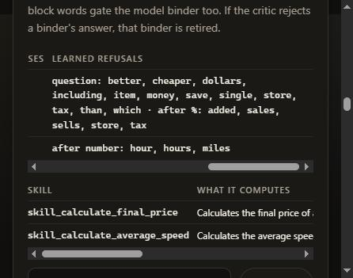

# Phase 12: Verified wording: misroutes stop protecting themselves

Previous: [Phase 11](PHASE-11.md) · Next: [Phase 13](PHASE-13.md) · [Index](README.md)

## The problem
Phase 11 ended with one misroute left: "20% off and then 5% sales tax is added" was answered as if the tax were a second discount. The tax is in the body of the task, not its question, so no question block word could see it.

The plan was to learn block words from the task body. Real run 1 showed the gap was deeper.

## What the real runs found
| Run | What happened | What it taught |
|---|---|---|
| 1 ([evidence](evidence-phase12-run1.json)) | Body block words were in place, but the lesson never formed. **(a)** The real mission never asked the skill: the director split the tax task into 4 subtasks, the agents worked it by hand, and the critic had nothing to reject. **(b)** The live home held **4 sales-tax misroutes stored as positive examples**, and "a block word never appears in a positive" made "tax" impossible to learn. The model-binder baseline in this same run saved every tax task and "fraction of the original" as positives too, erasing the block word "original" learned in Phase 11. | **Uncaught misroutes protect themselves.** A binding must be verified before it becomes a positive, and a lesson can't wait for a critic. |
| 2 ([evidence](evidence-phase12-run2.json)) | **Verified wording** and a **wording audit** were added. The audit demoted every poisoned positive (3 tax, 2 fraction, 1 "total discount %"). After it, **all 11 tax, tip and fraction controls were refused**, fresh wordings included. But the judge was **one agent run**, and it does this arithmetic worse than the skill: it answered 2, 4 and 900 for round trips, which demoted **15 of 17 correct speed examples**, and rounding ("51" vs 51.3) counted as disagreement. | A verifier must be stronger than what it verifies. **One dissent is not proof.** |
| **3** ([evidence](evidence-phase12-run3.json)) | **Two-agent judge.** **0 of 17** speed examples were wrongly demoted: the agents' wild answers (28,800, 1,000, 2) disagreed with each other and counted as inconclusive. The laptop and TV examples were kept because the second agent sided with the skill. The tax positives were demoted on corroborated refutations (107.1 / 107.1 and 126 / 126). | See below. |

**Run 3** compares the same home before and after the audit, plus 6 fresh tasks afterwards, with the full system: route if trusted, otherwise the agent loop answers and a shadow verdict follows.

| | Before (store still poisoned) | After the audit (+ fresh tasks) |
|---|---|---|
| Matching tasks answered with **zero model calls**, all correct | 5 / 6 | **7 / 8** |
| Tax and tip misroutes | **3 / 5** | **0 / 8** |
| "Fraction of the original" misroutes | 1 / 1 | 2 / 2 *(still open, see below)* |
| "How much do I save" | refused (answer-form gate) | refused |

- **Every** tax and tip task was refused, fresh wordings included ("plus 5% tax", "6% sales tax is added", "an 18% tip"), and the agents then answered most of them correctly.
- **Still open: "what fraction of the original price is left".** Both agents get it wrong too (0.325 vs 67.5, and 63 vs 28.82), so the old poisoned positives can't be refuted and stay. **The agency can only unlearn what at least two of its own agents can corroborate.**
- **Cost:** a task that can't be routed safely costs the agent loop it always cost; on disagreement a second agent also runs, about 10 calls instead of 5. Routed tasks still cost zero.

## What was built
- **Body block words** (`learnBlocks`):
  - Each number carries the next 3 content words in its clause ("5% sales tax is added" → sales, tax, added).
  - A number kind is **role-marked** when one context word repeats across at least half of the positives: "off" follows a percentage in most discount tasks.
  - After "$90 jacket" comes an item noun that differs in every task, so a refused jacket task **never** teaches the binder to refuse jackets (tested).
- **Lessons outlive binders:** block words come from the recorded examples, not the active binder, so they still hold when a retired binder has no replacement.
- **Critic rejections:**
  - a rejection **contests look-alike positives**: those sharing its rare role words are disputed (`contested`);
  - the binder is **relearned at once**.
- **Verified wording** (`novelWording`):
  - Once a skill has enough positives, a task whose role or question wording no positive used is not routed (`unverified wording ("tip")`).
  - The agent loop answers it, as it always would have.
  - A **shadow verdict** then judges the skill's output on the binding it *would* have used against that answer: verified becomes a positive (the wording is trusted from then on), refuted becomes a negative (the wording becomes block words), inconclusive teaches nothing.
- **The judge** (`#judge`):
  - The agent's last number that is not in the task counts as its answer; rounding to its own precision agrees.
  - On disagreement a **second, different agent** answers (`skills.secondOpinion`, default `lumen`). If it sides with the skill, the binding is verified. If it corroborates the first agent, the binding is refuted.
- **Wording audit** (`auditWording`): re-judges old positives that use rare wording (under 25% of positives). `POST /api/skills/:name/audit-wording`, `agency skills audit-wording <name>`.
- **Dashboard:** a "learned refusals" column on the binders table (`question: …` · `after %: …`).

## Tests
114 pass, including:
- `test/binder-induction.test.js`:
  - body block words, with item nouns never learned;
  - a confirmed failure contests its look-alike positives, so the lesson forms.
- `test/binder.test.js`:
  - a critic rejection is absorbed at once;
  - the lesson outlives the retired binder;
  - verified wording: tax is refused and then learned as a block word, while "loyalty discount" is verified and then routes with **zero model calls**;
  - the judge: rounding agrees; a second agent siding with the skill verifies; two agents disagreeing with each other teach nothing; a corroborated refutation becomes a negative.

## Files
- **Changed:**
  - `src/evolve/binder-induction.js`: `numberTokens` context, `learnBlocks`, `contested`, `wordingOf`, `novelWording`;
  - `src/evolve/crystallizer.js`: learned gate, shadow verdict, judge, audit, `rejectRoute`;
  - `src/agents/runtime.js`: shadow after the agent loop;
  - `src/agency.js`: `agentAnswer`;
  - `src/server/server.js` and `src/cli/cli.js`: audit-wording;
  - `web/src/main.ts`: learned refusals.
- **Evidence:** 3 runs, from harnesses at `F:\Claude-Work\eyeoverthink-agency\phase12-*.mjs`. Runs 2 and 3 start from the same pre-Phase-12 backup of the live home.

## Patterns used
- **Verify before you trust, not trust until refuted.** Recording a binding as a positive is a claim; it now needs evidence.
- **Free verification from work already being done.** The agent loop runs on unrouted tasks anyway; comparing its answer costs a sandbox run.
- **Independent corroboration** (as with the Red Queen keys): one dissent is noise, and two agreeing dissents are evidence.
- **Closed versus open vocabulary.** Role words repeat across examples and item nouns don't, which separates "what the number means" from "what the item is".
- **Learning when no lesson arrives.** Missions decompose tasks, so a rejection-driven lesson may never come; shadow verdicts learn from every declined task.

## What this enables next
- A stronger judge for tasks the agents can't solve (the fraction case), such as a program-verified answer key.
- Promoting a verified *pair* of wordings into a new skill: the tax tasks the agency now refuses are exactly the next skill to crystallize.
- Carrying skills, binders and verified wording between agencies in organism plasmids.
