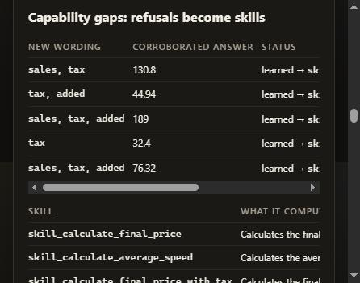

# Phase 13: Refusals become skills

Previous: [Phase 12](PHASE-12.md) · [Index](README.md)

## The problem
Phase 12 taught the agency what *not* to do. A tax task was refused by the discount skill and answered by the agent loop: about 10 model calls and 30–40 s every time, and the agents' arithmetic was often wrong.

But each refusal plus a corroborated agent answer is a **solved example of a capability the agency does not own yet**. If the library only grows from successes, every refusal is a capability lost for good.

## The idea
1. **Gap.** A task a skill refused, with an answer that independent agents corroborated, is recorded with its new wording as **markers** ("sales", "tax", "added").
2. **Family.** Gaps whose markers overlap form a family.
3. **New skill.** Once a family has 3 or more gaps, it is crystallized into a NEW skill. Admission now has two independent checks:
   - **differential testing** (Phase 9): the code agrees with a blind reimplementation;
   - **an answer key:** from inputs *grounded in each task*, the code must reproduce the agents' corroborated answers.

   Differential testing catches code that doesn't match its own description. The key catches a description that is wrong about the world. A candidate that treated tax as a second discount fooled its blind twin but scored 0 of 3 on the key (tested).
4. **Routing.** The key's verified bindings become the new skill's first examples. Its binder is induced from them (Phase 11), so the next task of that kind costs **zero model calls**.

## Measured on real models: three runs plus a probe
| Run | What happened | What it taught |
|---|---|---|
| 1 ([evidence](evidence-phase13-run1.json)) | Only **3 of 16** tax tasks got a corroborated answer: the two agents disagreed, even when one was right (189 vs 196.4; 130.8 vs 191). The one skill attempt **lost the vote**. The probe ([evidence](evidence-phase13-probe.json)) showed why: the 7B extractor read "20%" as 20 (90 × (1 − 20) × (1 + 6) = −11,970), while the **blind reference was correct and matched all 3 corroborated answers**. The correct code was discarded because it was only the referee. | A judge needs a tie-breaker, and ground truth must outrank a vote between models. |
| 2 ([evidence](evidence-phase13-run2.json)) | **2-of-3 judge:** a third agent on a different model breaks ties. **6 of 8** were corroborated, and all 6 answers were correct; twice the second agent outvoted a wrong first. Every skill attempt scored **0 on the key, for the candidate and the reference alike**: the bindings used 0.1 for "10%", but no schema said "decimal", so Phase 10 grounding refused them all. The model also merged tax and tip into one formula (`tax_or_tip`). | Repair the contract from evidence, *before* the reference reads it: a reference written from the unrepaired schema implemented whole-number percentages. |
| **3** ([evidence](evidence-phase13-run3.json)) | **End to end, from the same pre-Phase-13 backup.** See below. | |

**Run 3:**
- 5 tax tasks were refused, and each answer was corroborated 2 of 3 (all 5 correct).
- Two skill attempts failed the vote. The third, **`calculate_final_price_with_tax`**, was **admitted**:
  - answer key 5/5;
  - differential testing on 6 inputs;
  - contract repaired: `discount` and `tax_rate` are decimal fractions.
- Its binder was then induced with no model from those 5 verified bindings.

| After the skill was learned | Result |
|---|---|
| Tax tasks answered by the **new** skill | **7 / 7**, all correct, **0 model calls** each (was ~10 calls and 30–40 s, with the agents often wrong) |
| Discount tasks | still the parent skill, 0 calls, correct |
| "How much do I save" | still refused |
| "An 18% tip is added" | declined as unverified wording (`tip`); the shadow verdict then **agreed** with the new skill (63.72, second agent), so `tip` is now verified wording for it |

The arc: a refusal in Phase 12, a skill in Phase 13, then zero calls. Before admission, the 5 learning tasks used about 59 model calls. Afterwards the same kind of task costs nothing.

## What was built
- **`skill_gaps`** (migration v7) holds the task, the corroborated answer, the markers, and a status (open / learned → `resolved_by`).
- **The 2-of-3 judge** (`#judge`):
  - agreement verifies;
  - on disagreement a second agent answers (`skills.secondOpinion`, default `lumen`);
  - if the two agents also disagree, a third on a different model answers (`skills.thirdOpinion`, default `forge_keeper`);
  - any two that agree decide, and a refutation carries the **corroborated** answer.
- **`gapFamilies`** groups gaps by marker overlap (union-find). **`learnGap`** runs automatically (`skills.learnGaps`, `gapMin` 3), and again whenever the family grows.
- **In `crystallize(…, { answerKey })`:**
  - The extractor also returns one binding per solved task.
  - **Contract repair:** a parameter whose every binding equals its task's stated percentage ÷ 100 gets the missing "decimal fraction" clause, before the reference reads the contract.
  - **The answer key is checked first, against every implementation.** A reference that passes where the candidate fails is **promoted**, and a fresh implementation from another model must agree with it.
  - Verified bindings become the new skill's first positive examples.
- **Routing:** a gated parent no longer blocks a sibling skill; when the gated skill is the only candidate, refusal stays zero-cost.
- **Surfaces:** `GET /api/skills` (gaps), `POST /api/skills/:name/learn-gap`, `agency skills gaps | learn-gap <skill>`, and the dashboard's "Capability gaps" panel.

## Tests
119 pass, including `test/gaps.test.js` (5):
- `nearAnswer` rounding;
- three corroborated refusals become a skill that answers new tasks of that kind, while discounts stay with the parent;
- a tax-as-discount candidate fails the key despite its blind twin;
- a correct reference is promoted over a wrong candidate;
- contract repair for decimal bindings.

`test/binder.test.js` covers the 2-of-3 judge, including a third agent corroborating the *second*.

## Patterns used
- **Refusal plus corroboration makes training data.** The agency learns new capabilities from what it could not do.
- **Ground truth outranks a vote.** An answer key from the world beats agreement between models, and applies to every implementation.
- **Role symmetry.** Whichever implementation is right gets admitted, whether it was the candidate or the referee.
- **Contract repair from evidence:** fix the description, not the safety rule.
- **2-of-3 everywhere:** Red Queen keys, the skill tie-break, and now the judge.

## What this enables next
- **Skill composition:** chains of owned skills (discount, then tax, then split the bill) instead of one skill per family.
- **A program-verified judge** for tasks the agents can't solve (Phase 12's fraction case).
- **Carrying skills, binders and verified wording between agencies** in organism plasmids.
