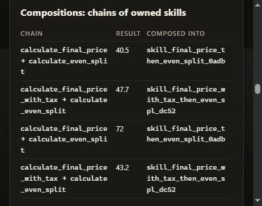

# Phase 14: Skill composition

Previous: [Phase 13](PHASE-13.md) · [Index](README.md)

## The problem
Every skill so far answers one kind of task. "A $200 dinner is 20% off, then 8% sales tax is added, and the total is split evenly among 4 friends" needs two skills the agency already owns, one feeding the other. Without composition, each new combination is a fresh capability gap: model calls, unreliable agent arithmetic, and eventually yet another monolithic skill.

## The idea
- **Chains.** The bind call may return a chain of 2–3 owned skills, where `{"ref": k}` is step k's output. It costs no extra model call.
- **The same gates, chain-wide:**
  - literals grounded per parameter contract;
  - refs only to earlier steps;
  - no dead steps;
  - every number the task states used, occurrence by occurrence;
  - the answer form matches what the last step computes.
- **Trust is earned.** A new chain shape is not trusted until the judge has verified it twice against the agent loop's answer, and then only for the wording those verified chains used.
- **The agency writes the composed skill itself, with no model:** code that calls the verified skills in order. It is admitted only if it reproduces every verified chain. Its verified chains seed a learned binder at birth, so the next task of that shape costs zero model calls.

## Measured on real models: six runs from the same backup
Each run starts from the pre-Phase-14 live home, which has no skill for splitting a bill. The harness first crystallizes that building block from a solved text (Phase 9: `calculate_even_split`, verified 2-of-3). Then it sends 6 learning tasks and 8 test tasks through the full system: discount + tax + split, two discounts + split, single-skill tasks, an 18% tip, and "how much more does Ann pay".

| Run | What happened | What it taught |
|---|---|---|
| 1 ([evidence](evidence-phase14-run1.json), [raw binder replies](evidence-phase14-binder-replies.json)) | **0 chains formed, 0 misroutes.** The 3B binder knew the task needed composing and bound every value correctly, but answered `{"skill":"chain","input":{original_price, discount, tax_rate, number_of_people}}`, or a single skill with "3 friends" left over. | **The model gives the values, the agency gives the structure:** search the orders of related skills where every value is used once and each later step is fed by the one before (`inferChain`), or extend a single binding by one step that uses the leftover numbers (`extendChain`). |
| 2 ([evidence](evidence-phase14-run2.json)) | Chains formed and were verified; one route through a trusted chain was correct; **two composed skills were written**. Then the 3B binder sent tax + split tasks to the **discount** composed skill. | A skill born from verified examples knows its verified wording from birth. The gate used to wait for 3 examples. |
| 3 ([evidence](evidence-phase14-run3.json)) | **0 misroutes**, but the composed skills never routed: the 3B binder rarely picked them among six skills, and once misspelled one. | Born skills learn their binder from their 2 verified chains, and a trusted chain route counts as an example of its composed skill. |
| 4 ([evidence](evidence-phase14-run4.json)) | The **tip** task was answered by the *trusted* discount chain (tip bound as a second discount) and saved as an example. The composed binder learned only "friends" and bound 1 of 4 "…4 **people**" paraphrases. "Split first, then tax" was inferred: equal by commutativity, but a different signature. | Trusted chains get the wording gate. **Unit widening:** a blind paraphrase that binds exactly once its unit is allowed teaches that unit, and then everything is re-verified. |
| 5 ([evidence](evidence-phase14-run5.json)) | The tax composed skill routed with zero calls and was correct, but **discount + split tasks were also routed to it with zero calls, and answered wrongly**. Its verified wording had "off" (after the 1st %) and "sales tax added" (after the 2nd); a discount task has "off" after *both*, so every word looked verified. | **Verified wording is positional:** "off after % #2" is new. Counted in the task's fullest line, so restated mission goals stay verified. |
| **6** ([evidence](evidence-phase14-run6.json)) | **Clean.** | See below. |

**Run 6:**
- **Learning:** all 6 answers correct. 4 chains were verified against the agent loop (43.2, 72, 47.7, 40.5), one inferred from a flat binding and one picked by the agent's answer between 2 valid structures, for each shape. **Both composed skills were born** and learned their binders at once.

| Test task | Answered by | Model calls | Correct |
|---|---|---|---|
| tax + split (2 tasks) | composed `final_price_with_tax_then_even_spl_dc52` | **0** | ✓ ✓ |
| two discounts + split | trusted chain `calculate_final_price > calculate_even_split` | 1 | ✓ |
| two discounts + split | composed `final_price_then_even_split_0adb` (its binder was fed by the trusted-chain route) | **0** | ✓ |
| single tax / single discount | their own skills | 0 | ✓ ✓ |
| "an 18% tip is added", split | declined (`tip after % #2` unverified); the shadow then **agreed** with the tax composed skill (35.4), so tip is now verified wording for it | agent loop | ✓ |
| "how much more does Ann pay than Bob" | refused | agent loop | – |

**0 misroutes in 14 tasks.** The composite test tasks cost 1 model call in total (the learning tasks cost about 5 calls each, at 20–30 s).

## What was built
- **Chain routing:**
  - `normalizeChain`, `chainSignature`, `chainProblem`, and `#runChain` (sandboxed; refs replaced by earlier outputs);
  - `inferChain` and `extendChain` return **every** structure that fits;
  - with several candidates, a single verified shape is used; otherwise all are kept as the shadow, and **the agent loop's answer picks one** (`skill.chain_pick`).
- **Trust:**
  - `skill_chains` (migration v8) holds the signature, task, steps, result and verdict;
  - `chainTrust` (default 2) verified chains are required, and a trusted shape answers only verified wording;
  - chain routes are ledgered as `skill.chain_route`.
- **Composition** (`composeChain`):
  - deterministic code calling `skill_<name>`;
  - parameters from the chain's literal slots, with their contracts copied;
  - an all-or-nothing answer key over the verified chains;
  - its examples seed the binder.
- **Born-verified skills** (source `chain:` or `gap:`):
  - the verified-wording gate applies from the first example;
  - the binder is learned from 2 examples.
- **Positional verified wording:** `wordingOf` tags each role word with the number it follows ("tax after % #2").
- **Unit widening in `learnBinder`**, with full re-verification.
- **Surfaces:** `GET /api/skills` (chains), `POST /api/skills/compose`, `agency skills chains | compose <signature>`, and the dashboard's "Compositions" panel.

## Tests
130 pass, including `test/compose.test.js` (11):
- chain gates;
- a composed skill reproduces its chain;
- judge, then composition, then **zero model calls**;
- refuted chains never compose;
- inference from the real 3B replies;
- an ambiguous structure decided by the agent's answer;
- born-verified wording;
- binder at birth;
- trusted chains only for verified wording ("tip");
- unit widening ("people").

`test/binder-induction.test.js` adds the positional-wording regression from run 5.

## Patterns used
- **Division of labour by strength:** the small model reads the values, a structural search assembles the chain, and the agents' answer settles ambiguity.
- **Deterministic synthesis:** composed code is written by the agency, not a model; the only new risk is the chain's shape, and two verdicts check it.
- **Born verified:** skills created from verified evidence skip the cold start (wording gate from the first example, binder from 2).
- **Position matters:** the same word after a different number is a different role.
- **Every trust path gets the wording gate:** skills (Phase 12), learned binders, trusted chains and composed skills.

## Known limits
- **Commutative chains** ("split, then tax" vs "tax, then split") are separate shapes, each verified on its own; merging them would require proving equivalence.
- **Composite tasks with unseen wording** fall back to the agent loop until verified (by design).

## What this enables next
- **Composed skills as building blocks** of longer chains: a library that compounds combinatorially.
- **A program-verified judge** for tasks the agents can't solve (the fraction case).
- **Carrying skills, binders, verified wording and composed skills** between agencies in organism plasmids.
