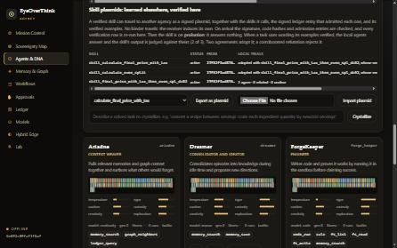

# Phase 15: Skill plasmids

Previous: [Phase 14](PHASE-14.md) · Next: [Phase 16](PHASE-16.md) · [Index](README.md)

## The problem
Everything the skill library learned so far stays inside one agency. The tax-then-split skill cost the agency about 59 model calls (learning the tax skill from refusals, Phase 13) plus the composition runs (Phase 14) before its first zero-call answer. A second agency, on another laptop or for another user, would pay all of that again.

The obvious fix (copy the database) would also copy every mistake, and would make each agency trust code it never checked.

## The idea
A skill travels as a **signed plasmid** (the same DNA-encoded, Ed25519-signed bundle that already carries agents between agencies), and the receiver trusts nothing it hasn't checked itself.

**What travels:**
- the skill's code, contract and verification rows (input → output);
- every skill it calls (a composed skill brings its building blocks), dependencies first;
- the sender's **signed ledger entry** that admitted each skill;
- its positive examples (task → binding). These are never negatives, and never from private work.
- the sender's binder **spec as data**: which number fills which parameter, and with which units.

**What doesn't travel:** binder *code*. The receiver induces its own and compiles any hint with its own compiler, so it never runs routing code it did not derive.

**On arrival, with no model:**
- the plasmid's signature and part hashes (optionally pinned to a trusted peer);
- each code hash, and each admission entry: its hash recomputed, its signature by the same signer, and the same code hash;
- every verification row re-run in the local sandbox;
- every example's binding grounded in its task;
- a name that already exists must be the same code.

**Probation, then adoption.** Imported skills answer **nothing** at first. When a task uses wording their examples verified, the local agents answer as usual, and the skill's output is judged against that answer by the same 2-of-3 judge. Two local agreements adopt it, and the skills it calls with it. A corroborated refutation rejects it. On wording the examples never verified, there is no trial at all: a near-miss ("another 10% off" for a tax skill) would refute a correct skill for the wrong reason.

Probation costs nothing extra: the agents were answering anyway, and the judge only spends extra opinions on disagreement.

## Measured on real models: four runs and a continuation
- **Sender:** a copy of the Phase 14 run-6 home. It exports `final_price_with_tax_then_even_spl_dc52` together with `calculate_final_price_with_tax` and `calculate_even_split`: 3 skills, 47 KB, signed.
- **Receiver:** a **brand-new agency** with its own identity and no skills.

The tasks: tax-then-split tasks, a discount-then-split near-miss, and "how much more does Ann pay".

| Run | What happened | What it taught |
|---|---|---|
| 1 ([evidence](evidence-phase15-run1.json)) | **Import refused**: "fewer than 3 verification rows". A composed skill is verified by its chains (2 at birth), and its building blocks bring their own rows. **Baseline without skills:** the agents spent 4–9 model calls per task and got 1 of 6 wrong. | A composed skill's minimum is 2 rows. The unit test for dependency bundling found the same thing at the same moment. |
| 2 ([evidence](evidence-phase15-run2.json)) | Imported. Trial 1: the first agent answered **17.28 (wrong)**, the second agent sided with the skill (51.84, correct). Trial 2 agreed. **Adopted after 2 tasks**, with both dependencies. Then the composed binder was refused: it bound only 25% of the blind paraphrases, so later tasks went to the agents. | The receiver lacked what the sender had learned about routing ("people" as a unit, Phase 14). → The **binder spec travels as data**. Units are merged only where the receiver's own induced selector is identical, then fully re-verified. |
| 3 ([evidence](evidence-phase15-run3.json)) | The binder was refused again, for a new reason: the model's "near-miss" tests included *"A $200 dinner is discounted by 20%, then an 8% sales tax is added, and the total is split among 6 friends"*, which is exactly what the skill computes. | A blind negative is one model's label, not ground truth. → **A blind negative that binds is judged** by the 2-of-3 judge: agreement relabels it as a positive, and corroborated dissent keeps the refusal. Recorded refusals are never relabeled. |
| 4 ([evidence](evidence-phase15-run4.json)) | Both binders admitted at **100%** coverage. Adopted after 2 trials. The next 3 tasks still went to the agents. With 5–6 positives, "dinner" followed "$" in 3 of them, so "$" counted as role-marked, and each new item noun ("group lesson", "boat tour") was gated, answered by the agents and verified by the shadow check. | The gate is being conservative, not wrong: every one of those answers was checked. A stricter rule (2/3) was **measured** on every real skill's examples and would switch the wording gate off for two existing skills, so the rule stays. |
| 4b ([evidence](evidence-phase15-run4b.json)), same receiver | Fresh tasks with new nouns ("cooking class", "escape room", "pizza order"): **3 of 4 answered by the imported skill with 0 model calls in 0.1 s, all correct.** The fourth ("6 **people**") was bound thanks to the imported unit, but "people" was not yet verified wording, so the agents answered and the shadow check verified it. The discount near-miss was not misrouted. | |

**What the receiver paid** to own a skill that cost the sender about 59 model calls plus two phases of runs: **2 ordinary answered tasks**, with no extra calls for the trials. After that, matching tasks cost 0 calls in 0.1 s. That compares with 3–18 calls and 5–41 s from the agents, who got **6 of 26** checkable answers wrong across these runs.

Its ledger verifies end to end, and every skill row traces back to the sender's signed admission entry and the receiver's own signed adoption.

## What was built
- **`exportSkill(name, identity)`:**
  - collects the skill's dependencies through `skill_<name>` calls, recursively;
  - packs the parts `skills.json`, `examples.json`, `binders.json` (specs as data) and `provenance.json`;
  - ledgers `skill.export`.
- **`importSkill(plasmid, { trustSigner })`:**
  - the checks above;
  - skills arrive with status `probation` and source `import:<signer>`;
  - examples are copied, and unit hints are kept as `binder:hint:<skill>`;
  - ledgers `skill.import` / `skill.import_reject`.
- **Probation routing:**
  - `route()` wraps the owned routing; when nothing owned answers or is already being judged, `#probationTrial` binds with a spec induced from the imported examples (no model, verified wording only);
  - `#trialVerdict` judges the trial, ledgers `skill.trial`, and moves the skill to `active` (adopting its dependencies, with one `skill.adopt` each, so the receiver can re-export them) or to `rejected`.
- **`learnBinder`:**
  - imported unit hints are merged only into an identical selector, then re-verified;
  - blind negatives that bind are judged, and relabeled on agreement (`binder.relabel`).
- **Imported skills count as born verified** (like `chain:`/`gap:`): the wording gate applies from the first example.
- **Surfaces:**
  - `GET /api/skills/:name/plasmid` and `POST /api/skills/import`;
  - `agency skills export <name> [file]` and `agency skills import <file> [--signer]`;
  - the dashboard's "Skill plasmids" panel (trials, signer, reproduced rows, and "adopted with" read from the signed `skill.adopt` entries, plus export and import buttons).

## Tests
137 pass, including:
- `test/plasmid.test.js` (3):
  - a round trip: re-verified, no answers on probation, no trial on unverified wording, adopted after 2 agreements, then routed, then re-exportable by the receiver with a valid ledger;
  - refusing a re-signed forgery, a tampered strand, and an untrusted signer;
  - an honestly wrong skill that reproduces its own rows: it passes import, but is **rejected by the receiver's own agents**.
- `test/compose.test.js`:
  - a composed skill travels with its 3 dependencies, and re-import is a no-op;
  - a mislabeled blind negative is relabeled when the agents agree, and still refuses the binder when they corroborate a different answer.

## Patterns used
- **Trust is local.** Signatures prove who sent a skill, not that it is right. Correctness is re-established on the receiver's own tasks, by its own agents.
- **Data, not code, for anything that routes.** Specs travel and are re-compiled and re-verified. Binder code never travels.
- **Probation in the shadow.** A new skill is evaluated where the answer was being computed anyway, so it costs nothing and risks nothing.
- **One model's label is an opinion.** Test cases written by a model are evidence to judge, not ground truth.
- **Measure before tightening a rule.** The proposed stricter wording rule was checked against every real skill first, and rejected.

## Known limits
- **Item nouns that repeat by coincidence** make the wording gate conservative for a few tasks after adoption. Each such task is still answered correctly by the agents, and verifies the noun.
- **Adoption needs tasks with wording the examples verified.** A receiver whose users phrase things differently stays on agent answers until the shadow verifies its wording, which is by design.
- **Transfer is by file or HTTP API.** Sending a plasmid over the signed agency mesh is the obvious next step.
