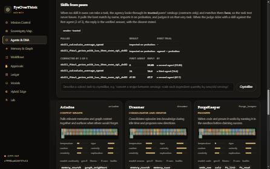

# Phase 16: Skills over the mesh

Previous: [Phase 15](PHASE-15.md) · Next: [Phase 17](PHASE-17.md) · [Index](README.md)

## The problem
Phase 15 made skills portable, but someone still had to export a file and import it. The agency should get what it lacks by itself: when it meets a task no skill it owns can take, ask the agencies it trusts, without telling them what the task was.

## The idea
Three envelope types on the existing signed mesh (Ed25519, ±300 s window, single-use nonces):

| Type | Who may send it | What happens |
|---|---|---|
| `skill.catalog` | any known peer | the reply lists the agency's active skills: contracts and evidence counts, **never code or examples** |
| `skill.request` | trusted peers only | the reply is a signed skill plasmid (Phase 15), which must be signed by that same peer |
| `skill.offer` | trusted peers only | the plasmid is imported on **probation**, never trusted as is |

**Seeking.** After the agents answer a task where no owned skill was even a candidate, the agency looks for one in the background, never delaying the answer:
1. It reads its trusted peers' catalogs (cached for 10 minutes).
2. It matches them **locally** with the same prefilter routing uses.
3. It pulls the best skill it has never seen (by name or code hash).
4. It judges that skill **on the very task** that started the search, using the answer the agents just gave.

Only a skill name ever leaves. **The task text never does.** A skill once rejected or already on probation is never pulled again.

**The verdict decides the reply** (found in run 1, below). When the 2-of-3 judge sides with a skill *against* the first agent (a second or third agent agrees with the skill), the reply becomes that verified result, with the dissent stated. When the agents only rounded the skill's exact result ("24" for 23.85), the reply is the exact value. When the dissent is corroborated, the agents' answer stands.

## Measured on real models: two real agencies over HTTP
- **Sender:** a copy of the Phase 14 home with 6 skills.
- **Receiver:** a brand-new agency with no skills.
- They paired over HTTP and trusted each other. The receiver was then given only tasks: 4 tax-then-split, 4 round-trip speed, and 1 control.

| Run | Correct (of 8) | What happened | What it taught |
|---|---|---|---|
| 1 ([evidence](evidence-phase16-run1.json)) | 4 | Without any operator action, the receiver pulled `final_price_with_tax_then_even_spl_dc52` (with its 2 building blocks) on the first tax task, and `calculate_average_speed` on the first speed task. Each was adopted after 2 agreeing verdicts; sp4 then took **0 model calls, 0.1 s**. But twice **the first agent was wrong** (49.28, 50), a second agent sided with the skill, and the user still got the wrong answer. | The verdict should decide the reply, not only what is learned. |
| 2 ([evidence](evidence-phase16-run2.json)) | 6 | **2 corrections**: 7.5 → **30.24** (a second agent agreed with the skill); 2.68 and 8 → **14.4** (a third agent sided with the skill). One answer was still off: the agents said "24" for 23.85, and the judge rightly counted that as agreement at the agent's rounding. | When agreement is only by rounding, reply with the exact verified value. |
| **3** ([evidence](evidence-phase16-run3.json)) | **7** | **3 corrections**: 47.85 → 47.7; 24 and 2 → 14.4 (third agent); 8 → 23.85. The one miss (sp1) came before the receiver owned any speed skill: the skill was pulled after that answer, and the task's wording was new to it, so there was no immediate trial. | |

**Every run:**
- The sender received exactly 3 messages (`skill.catalog` and `skill.request`), and **none of the 9 task texts**.
- Both ledgers verify.
- The control ("how much more does Ann pay") pulled nothing and was answered by the agents.

## What was built
- **`Mesh`:**
  - handles `skill.catalog`, `skill.request` and `skill.offer` (with the trust levels above);
  - client calls `catalog(peer)` (cached), `requestSkill(peer, name)` (the reply must be signed by that peer) and `offerSkill(peer, name)`;
  - ledgers `mesh.skill_in` / `mesh.skill_out`.
- **`Agency.seekSkills(task, final)`:**
  - trusted peers only, matched locally with `relevance()` (the routing prefilter, now shared);
  - pulls up to 2 candidates, then `Crystallizer.trialNow`;
  - ledgers `skill.seek`.
  - The runtime queues it in the background when routing found no candidate and the work is not private.
- **`Crystallizer.correctAnswer(verdict, final)`:** 2-of-3 outvoting and exact-value precision. Ledgers `skill.correct`, and is applied by the runtime after every shadow or trial verdict.
- **Surfaces:**
  - `GET /api/mesh/peers/:id/skills`, `POST …/skills/request` and `POST …/skills/offer`;
  - `agency mesh [add | trust | skills | pull | push]`;
  - the dashboard's "Skills from peers" section: peers, a catalog browser with Pull buttons, recent seeks, and 2-of-3 corrections.

## Tests
140 pass, including in `test/plasmid.test.js`:
- **Over real HTTP:**
  - catalogs carry no code;
  - a skill isn't handed to an untrusted peer;
  - seeking pulls the matching skill and judges it on the triggering task;
  - adoption, then routing;
  - **the sender never sees the task text**;
  - no second pull;
  - an offered skill lands on probation, and only from a trusted peer.
- **The verdict decides the reply:** a wrong first agent is outvoted 2 of 3, rounding becomes the exact value, and a corroborated dissent is not overridden.

One full-suite run, the first after the edits, showed 5 failures that never reproduced in 6 later runs. It is recorded here rather than ignored.

## Patterns used
- **Pull by need, match locally.** Peers learn which skill names you asked for, never what you were working on.
- **Trust levels by consequence.** Reading a catalog is harmless (known peers); receiving code needs trust, and still lands on probation.
- **The judge's majority is the answer.** The same 2-of-3 rule that decides what is learned now decides what the user is told.

## Known limits
- **The first task of a kind is answered before the pulled skill exists**, so it can't be corrected; only later tasks benefit.
- **Seeking only runs when no owned skill was a candidate.** A task near an owned skill that doesn't fit it does not search the mesh.
- **Catalog matching uses word overlap.** A peer's skill described in different words won't be found.
