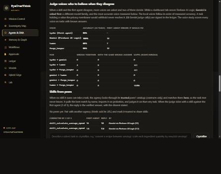
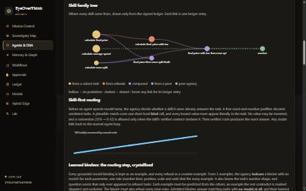

# Phase 17: Gemini as a judge, measured voices, and the skill family tree

Previous: [Phase 16](PHASE-16.md) · Next: [Phase 18](PHASE-18.md) · [Index](README.md)

## The problem
Everything the agency learns passes through one judge. When a skill and the first agent disagree, more agents are asked, and two of three decide. Until now every voice was a local model, and it was never measured how good each one is. Phase 16 also showed that the judge can know the right answer while the user is still given the wrong one; that was fixed there. Here the question is **who to believe**.

This phase also started from a review of the user's earlier platform, chandra-fraymus. An agent read the whole app; its claims were spot-checked against the source. Three of its methods are used here:
- **an outside referee scoring a judge**, with Cohen's kappa (`memory-gold.js` `agreement()`);
- **a guard before any cloud call** (`secretIn`), done here with the agency's own privacy membrane, which detects more;
- **running each verification row twice**, so a skill must be deterministic (`skill-forge.js`).

Its visual grammar (colour = kind, ring = evidence, nothing moves unless it happened) shaped the family tree.

## What was built
- **Gemini through Firebase AI Logic as a judge voice.**
  - While a dashboard tab serves as the edge worker, the judge asks Gemini first, as an edge job (`prefer_in_cloud`), signed into the ledger as `edge.inference` with origin `judge`.
  - A reply counts only if it really came from the edge. The router's local fallback would silently be a different voice, so it is discarded and the next voice is asked.
  - With no worker online, the judge behaves exactly as before.
- **A guard before the cloud.** Judged work is never private, but if its text holds anything the membrane would withhold (a key, an email, a card, an owner term), Gemini is not asked (`judge.cloud_refused`). There is also a daily cap (`skills.cloudJudgeDailyMax`, default 200).
- **The voice study** (`POST /api/skills/voice-study`): every voice answers the same tasks with known answers. It reports:
  - per-voice accuracy;
  - how often two voices are wrong together, and with the *same* wrong number (the failure a vote cannot fix);
  - Cohen's kappa on right/wrong for every pair;
  - how many first-agent errors each voice would fix.

  Evaluation mode (`skills.judgeAllVoices`) also records every voice on every live split.
- **A measured voice order.** Once a study exists, the local voices are asked in order of measured accuracy (`skills.voiceOrder: 'fixed'` restores the configured order).
- **A determinism check:** each candidate's test inputs, and each imported verification row, are run twice. A skill whose output changes between runs is refused.
- **The skill family tree** (`GET /api/skills/lineage`, dashboard): built **only from signed ledger entries**.
  - Nodes are skills and peer agencies. Each edge is one ledger entry (seq + hash): learned from refusals, composed, imported, or shared.
  - Colour = how the skill was born; ring = evidence; hollow = on probation.
- **Bugs fixed on the way:**
  - The router ordered plugin providers ahead of an explicitly requested edge model, so a call meant for Gemini could run locally.
  - A thousands separator was misread in two places: "1,250.5" was read as 250.5 in the voice study and in the Phase 14 picker that chooses between possible skill chains (a regex had lost its `\d`).

## Measured on real models
**Live judging** ([evidence](evidence-phase17-run1.json)): 10 tasks in new wording, against a copy of the Phase 14 home, with the dashboard tab serving Firebase AI Logic.

| Task | First agent | Gemini | Outcome |
|---|---|---|---|
| jog, round trip | 1.8 | **7.2** ✓ | reply corrected to 7.2 |
| hill climb, round trip | 16 (averaged 8 and 24) | **12** ✓ | reply corrected to 12 (lumen said 3) |
| dinner with "a 10% service fee" | 33 ✓ | **33** ✓ | an owned skill had treated the fee as a second discount (27): **refuted**, and the wording learned as a refusal |

All 10 replies were correct. After the speed wording was verified, the next 5 speed tasks took **0 model calls, 0.1 s**.

**Voice study** ([evidence](evidence-phase17-voice-study.json)): 20 tasks with answers computed in code (round trips, reversed percentages, work rates, weighted averages, successive percentages, compound growth, splits).

| Voice | Accuracy | First-agent errors it would fix |
|---|---|---|
| tycho (answers tasks first) | **50%** | – |
| **Gemini** (Firebase AI Logic) | **100%** | 10 of 10 |
| lumen | 65% | 7 |
| forge_keeper | 95% | 10 of 10 |

Altogether, **23 Gemini judge calls** across the live run and the study, all `IN_CLOUD`, with a median of 1.3 s, every one signed in the ledger.

**What the study did not confirm:** the starting hypothesis was that local models fail *together*. Only tycho and lumen were ever wrong on the same task (3 times), never with the same wrong number, and kappa between the voices was about 0. On these tasks their errors look independent. Gemini's value here is **accuracy**, not independence. The code and the dashboard now say exactly that.

**What it did show:** the agent that answers tasks first is the weakest voice (50%). The fixed judge order asked the 65% voice before the 95% one; the order is now measured.

## Tests
149 pass, including `test/judge-voice.test.js` (8):
- a real edge job served by a simulated browser worker, with origin `judge` in the ledger, and a local fallback reply discarded;
- the voice order, skipping a voice that gives no answer, and the voice named in corrections;
- the cloud guard (email and an owner term), with no edge job ever created, and the daily cap;
- evaluation mode with the decision unchanged;
- the voice study's accuracy, wrong-together counts and kappa;
- thousands separators;
- the measured voice order.

Also: the determinism refusal (`test/crystallizer.test.js`), and family-tree links that are ledger entries (`test/plasmid.test.js`).

## Patterns used
- **Measure the judge, then trust it.** An outside referee (answers computed in code) scores every voice.
- **Say what the data did not show.** The correlated-failure hypothesis was dropped from the code and the UI when the study failed to confirm it.
- **The evidence picks the order.** Voice order follows measured accuracy, not configuration.
- **Every picture is a proof.** The family tree draws nothing that isn't a signed ledger entry.

## Known limits
- **20 tasks is a small study**, and its tasks are arithmetic word problems; accuracy on other kinds of tasks is unmeasured.
- **Gemini needs a dashboard tab serving as the edge worker.** Without one, the judge is local only.
- **The first agent (tycho) is the weakest voice measured.** Choosing which agent answers first, by measurement, is the obvious next step.
