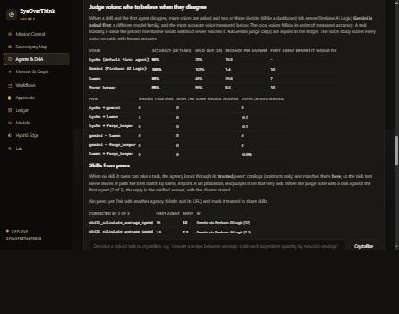
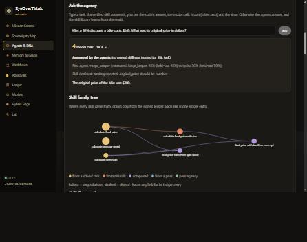

# Phase 18: The measured first agent

Previous: [Phase 17](PHASE-17.md) · [Index](README.md)

## The problem
The Phase 17 voice study found that the agent answering tasks first, tycho, was the **weakest** voice measured (50%). forge_keeper scored 95% on the same 20 tasks. The obvious move is to let forge_keeper answer first.

But that choice was *selected* on those 20 tasks. Phase 3 learned the hard way that a winner picked on one set can be luck. So the choice has to hold on tasks it was never picked on, and its cost in time has to be known.

## Why forge_keeper wins
It is the method, not luck:
- forge_keeper runs on the `code` role (qwen2.5-coder:7b), and its prompt says to write small programs and verify them by running them;
- tycho and lumen reason in prose on the `reason` role (fraymus-prime).

On arithmetic word problems, computing with code wins. It's the same idea the whole skill library is built on.

## What was built
- **`Agency.pickAnswerer(task)`.** It chooses the most accurate **local** agent to answer first, and only when all of these hold:
  - the task is inside the measured domain (at least 2 stated numbers; the studies only measured arithmetic word problems);
  - a voice study exists (at least 10 items);
  - the pick beats the default by a margin (`skills.answererMargin`, 0.15);
  - **a separate held-out study confirms it** (`judge:heldout`).

  Gemini never answers first: it stays a judge, so cloud use remains the exception. Every pick is ledgered (`agent.pick`) with its reason.
- **`ask('auto', task)`** and `POST /api/agents/auto/ask`. The dashboard's Ask box uses it and shows the first agent and why.
- **A voice never seconds itself.** The judge no longer asks the agent that gave the first answer for a "second opinion". It would have, the moment the first agent changed.
- **The voice study** records seconds per voice, runs in the background on the server (a long study had outlived the HTTP client), and stores held-out runs separately (`heldout: true`). `GET /api/agents/pick?task=…` explains the choice for any task.

## Measured on real models
**Held-out study** ([evidence](evidence-phase18-heldout.json)): 20 new tasks of the same kinds (round trips, reversed percentages, work rates, weighted averages, successive percentages, growth, splits), with different scenarios and numbers.

| Voice | Phase 17 study | **Held-out** | Seconds per answer |
|---|---|---|---|
| tycho (default first agent) | 50% | 70% | 15.3 |
| **forge_keeper** | 95% | **95%** | **8.3** |
| Gemini (judge only) | 100% | 100% | 1.4 |
| lumen | 65% | 45% | 25.6 |

- **The pick held:** forge_keeper beats tycho by 25 points on tasks it was never selected on, **in about half the time**.
- Across all 40 tasks: Gemini 40/40, forge_keeper 38/40, tycho 24/40, lumen 22/40.
- The Phase 17 finding repeated: only one pair of voices ever gave the same wrong number in 20 tasks.

**Live, through `auto`** ([evidence](evidence-phase18-live.json)): 5 new in-domain tasks.

| Task | First agent | Answer | Correct |
|---|---|---|---|
| goat round trip | (an owned skill answered: **0 calls, 0.1 s**) | 3 | ✓ |
| chair after 40% off | forge_keeper | 150 | ✓ |
| two printers together | forge_keeper | **24** (should be 4) | ✗ |
| −10% then +10% | forge_keeper | 1 | ✓ |
| bike after 20% off (dashboard) | forge_keeper | 300 | ✓ |
| one sentence about bread | tycho: outside the measured domain | – | – |

So **4 of 5** in-domain answers were correct, each in 4–17 s.

The printer miss is real, and nothing caught it: no owned skill matched the task, so there was no second computation for the judge to compare against.

## Tests
151 pass, including in `test/judge-voice.test.js`:
- the measured pick: only inside the domain, only with a study, a margin and a confirming held-out study; never Gemini first; it falls back to the default when the held-out study disagrees;
- a voice never seconds itself.

## Patterns used
- **Selected on one set, confirmed on another.** The same rule as evolution's fresh seeds (Phase 3), applied to choosing an agent.
- **Measure the cost too.** A more accurate choice that took twice as long would be a trade-off. This one is faster.
- **Stay inside what was measured.** Outside the studied domain, the default agent answers.
- **Local first, cloud as a check.** The most accurate voice measured is Gemini, but it stays a judge.

## Known limits
- **The measured domain is arithmetic word problems.** Missions still assign agents by role through Genesis; the measured choice applies to direct asks.
- **When no skill matches, an agent's wrong answer goes out unchecked** (the printer task). Asking a second voice on every in-domain answer would catch it, at the cost of one extra answer each time.
- **40 tasks is still a small sample.**
