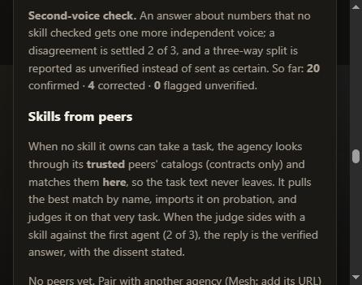

# Phase 19: Second-voice check

Previous: [Phase 18](PHASE-18.md) · [Index](README.md)

## The problem
The judge only runs when there is a second computation to compare against: an owned skill's shadow or trial. In Phase 18, forge_keeper answered "24 hours" for two printers working together (the answer is 4). No skill matched the task, so nothing checked it, and the wrong number went out.

## The idea
An answer about numbers that nothing else checked gets **one more independent voice**.

**Which voice:** Gemini through Firebase AI Logic when a worker is online and the privacy guard allows it; otherwise the most accurate measured local agent that did not give the first answer.

| The voices… | Reply |
|---|---|
| agree | the answer, marked *"Checked: Gemini via Firebase AI Logic independently got 4."* |
| disagree, and a third voice sides with the second | **corrected**: the 2-of-3 answer, stating that the first answer was outvoted, with the first answer kept for reference |
| disagree, and the third sides with the first | the first answer, checked 2 of 3 |
| all differ | the first answer, marked **Unverified**, with the disagreeing values listed and confidence lowered |

**When it runs:**
- only in the measured domain (tasks stating at least 2 numbers);
- never for private work, seeded runs (benchmarks, evolution) or missions, which have their own critic;
- never for the check voices' own runs (`check: false`). Without that, every check would trigger another check.

**Local voices come from every measured agent.** The judge used a fixed local pair (lumen, forge_keeper). With forge_keeper answering first (Phase 18), that left only lumen, the weakest local voice measured. Local voices are now every agent in the studies, ranked by accuracy over both studies weighted by size (`measuredAccuracy()`): forge_keeper 95%, tycho 60%, lumen 55%.

## Measured on real models
12 new number tasks with known answers, none of them answerable by an owned skill: work rates, reversed percentages, successive percentages, weighted averages, mixtures, growth and decay, rates, and splitting a bill after a charge.

| Run | First agent | First answers correct | **Replies correct** | Corrected | Unverified | Wrong and not flagged |
|---|---|---|---|---|---|---|
| 1 ([evidence](evidence-phase19-run1.json)) | forge_keeper (measured choice) | 12/12 | **12/12** | 0 (all 12 confirmed by Gemini) | 0 | 0 |
| 2 ([evidence](evidence-phase19-run2.json)) | tycho (the weaker default) | 8/12 | **12/12** | **4** | 0 | **0** |

**Run 2's corrections**, each by Gemini and forge_keeper outvoting tycho:
- the printer task: 4.8 → **4**;
- the salary before a 20% raise: 2400 → **2500**;
- +25% then −20%: 1% → **0%**;
- the runner's 8 km: 2400 → **40** minutes.

**Cost:** a confirmation adds one Gemini call (about 1.4 s). A correction adds two voices (roughly 10–20 s). Run 1 shows the common case: with the measured first agent, the check almost always just confirms.

## Tests
152 pass, including in `test/judge-voice.test.js`:
- the real Phase 18 miss (24 → 4) corrected by Gemini and tycho;
- forge_keeper is never asked to check itself;
- confirmation costs one voice;
- a three-way split is reported as unverified, with confidence at 0.4 or below;
- no check outside the domain, for `check: false`, or for private work.

Three older tests now expect the new *"Checked: …"* line, since the check runs on their in-domain answers too.

## Patterns used
- **Check what nothing else checked.** Skills have shadows and trials; plain agent answers now get one more voice.
- **Admit uncertainty.** A three-way split says so, rather than sending one of the numbers as if it were sure.
- **Cheapest independent voice first.** Gemini answers in about 1.4 s and was the most accurate voice measured, so the usual cost of checking is small.

## Known limits
- **The domain is numbers in word problems.** Prose answers are not checked.
- **If both check voices make the same mistake as each other**, they can outvote a correct first answer. In 40 study tasks, Gemini never made a mistake at all.
- **Without a Firebase worker online**, the check voices are local, and slower (tycho about 15 s per answer).
