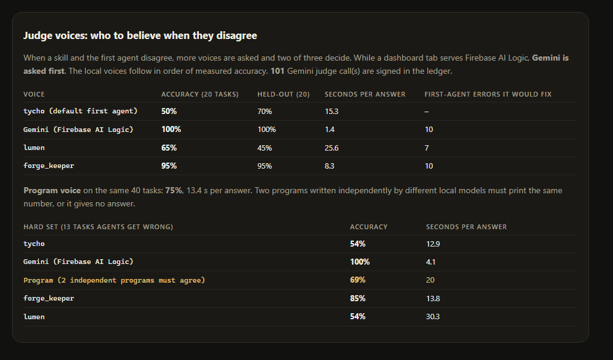

# Phase 20: Program-verified judge voice (and 20b: unsupported positives)

Previous: [Phase 19](PHASE-19.md) · [Index](README.md)

> Built on the `phase-20-program-judge` branch, after the contest freeze. `master` stays as judges saw it (tag `contest-freeze`).

## The problem
Every judge voice so far is an agent reasoning in prose. On hard arithmetic they can all be wrong together. Phase 12 found a poisoned positive, "what fraction of the original price is left", where every agent erred, so nothing could correct it.

A program can be exact. But Phase 8 measured that a single program is not proof: 5 of 6 examiner programs ran cleanly and answered the **wrong question**.

## The idea: N-version programming
The program voice (`src/evolve/program-voice.js`) works like this:
1. **Two different local models write programs.** The `code` role (qwen2.5-coder) and the `reason` role (fraymus-prime) each write a small JavaScript program from the task alone.
2. **Each program runs in the sandbox.** The sandbox is permission-locked, and a program must print exactly one number.
3. **If the two agree, that number is the voice's answer.** Agreement means within a relative 1e-6, or equal when rounded to at least 2 decimals.
4. **If they disagree, a third program decides 2 of 3.** It is written by the `plan` role (hermes3).
5. **Otherwise the voice says nothing.** It never guesses.

Everything runs locally, so no task text leaves the machine. The ledger records `judge.program` with the task's **hash**, the verdict, the answer and each program's vote, never the task text.

**The voice joins the measured local pool:**
- It is ranked by `measuredAccuracy()` like any agent, over the standard studies plus `judge:hard` and `judge:program`.
- `skills.programVoice: false` turns it off.

## Two judge changes found by auditing
- **A three-way split asks further voices.** The judge stopped at 3 voices, so in the first audit the program voice was never asked on the one case it was built for. On a split, the judge now asks the remaining voices up to `skills.maxVoices` (default 4) until two answers agree. The extra answers are kept in `row.extra`.
- **A fraction and its percentage are the same answer** when the task asks for a fraction or percent: 0.675 matches 67.5. Without this rule, a correct program (0.675) "disagreed" with a correct agent (67.5).

## Measured on real models

### What broke first (v1), and why
| Set | Program voice v1 | Wrong |
|---|---|---|
| Hard set (13 tasks agents get wrong) | 23% | 0 |
| Standard 40 tasks (Phases 17–18) | 47.5% | 0 |

**It never gave a wrong answer, but it was mostly silent.** The ledger and a direct probe showed why:
- **The `plan` role failed 31 of 31 tie-breakers.** The prompt said `"program": "<JavaScript>"`, and hermes3 copied the placeholder literally, wrapping every program in `<JavaScript>…</JavaScript>` tags.
- **The `reason` role wrote correct programs 47% of the time**, against 85% for the `code` role.

**Fixes:**
- `normalizeProgram()` strips tags, code fences and a leading `javascript` label;
- the prompt now shows a real example program and asks for standard built-ins and no comments;
- answers are rounded to 12 significant digits (`0.8*0.75` printed `0.6000000000000001`).

### After the fixes (v2)
| Voice | Hard set (13) | Seconds per answer |
|---|---|---|
| Gemini (Firebase AI Logic) | **100%** | 4.1 |
| forge_keeper | 85% | 13.8 |
| **program** | **69%** (9 right, **0 wrong**, 4 silent) | 20.0 |
| tycho | 54% | 12.9 |
| lumen | 54% | 30.3 |

On the standard 40 tasks, the program voice went from 47.5% to **75%**: 30 right, 3 wrong, 7 silent, at 13.4 s per answer.

**The 3 wrong answers are the important finding.** All 3 were round trips, and each answer was exactly half the truth. In each case, two programs written by **two different models** made the same mistake and agreed. N-version programming assumes the versions fail independently. Here they did not: the models share the same misreading of the question. That is the same correlated-failure limit Phase 19 recorded for agents.

*The Judge voices panel, with the program voice's standard-set line and the hard-set table. The panel's HTML was rendered at full width for this capture.*

Evidence: [hard v1](evidence-phase20-hard-v1.json), [hard v2](evidence-phase20-hard-v2.json), [program v1](evidence-phase20-program-v1.json), [program v2](evidence-phase20-program-v2.json).

### Auditing the discount skill's rare positives
`POST /api/skills/calculate_final_price/audit-wording` asks the judge again about every positive that was learned from rare wording.

**Audit v1:** 19 audited, 3 voices at most.
- **2 demoted.** These are wrong questions that the price skill had wrongly claimed: "what fraction of the original price is left" ($60 jacket) and "total discount as a percentage" ($80 dress).
- **1 unclear:** "An $80 jacket is 25% off, then 10% off. What fraction of the original price remains?"
  - The voices said 67.5 (first agent), 27 (Gemini) and 40 (forge_keeper).
  - The program voice was never asked.
- 16 kept.

**Audit v2**, with the 4th voice and fraction matching: 17 audited (the 2 demoted rows were already gone), and 16 kept again.
- **The jacket row is still unclear.**
- **The program voice was asked this time and gave the correct answer**, 0.675.
- **This time the first agent said 65**, not 67.5, so all four answers differed: 65, 27, 40 and 0.675.
- No two voices agreed, so the judge did not act.

**The honest reading:**
- The program voice was the only correct voice on the hardest case, and agreed with no other voice.
- **None of the four voices supported the skill's answer (54).**
- The judge's rule is "two voices must agree on an answer". It has no rule for "no voice supports the positive". That rule is the natural next step, and it is not built here.

### Phase 20b: demote a positive that no voice supports
**The rule.** It applies only in a wording audit (`auditWording`):
- If the judge ends undecided after **at least `skills.unsupportedMin` (default 4) voices answered**, and **none matched the skill's output**, the positive is demoted.
- **No gap is recorded.** Nothing was corroborated, so the four answers never become training data for a new skill.
- **The worst failure is a refusal.** That wording goes back to the agents, so the rule can never produce a wrong answer.
- The ledger counts these demotions as `unsupported` in `binder.audit_wording`.

**The test** (in `test/binder.test.js`):
- With only 2 voices answering, the positive is kept.
- With 4 unsupporting voices, it is demoted, with no corroborated answer.
- A supported positive in the same audit is kept.

**Audit v3 (real models): the jacket row is demoted, but not by the new rule.**
- This time the first agent said **67.5**, not 65.
- The fourth voice (the program, 0.675) matched it through the fraction/percent rule: `program corroborated first`.
- **So the 4th voice and fraction matching resolved the case. The new rule did not have to fire.**
- The first agent's answer changed between runs (67.5, then 65, then 67.5). The new rule covers the run where nothing agrees.
- The one other row left undecided ($18 pizza) had no first answer at all, so it was correctly left alone.

**Result:** after three audits, all 3 poisoned positives in the discount skill have been demoted. This includes the Phase 12 case that, at the time, no agent could correct.

Evidence: [audit v1](evidence-phase20-audit-v1.json), [audit v2](evidence-phase20-audit-v2.json), [audit v3](evidence-phase20-audit-v3.json).

## The tests
157 tests pass. `test/program-voice.test.js` covers:
- agreement, and 2 of 3;
- no answer when the programs disagree (no guess);
- unwrapping tags and fences;
- the judge integration: the ledger holds the task hash, not the text;
- the fourth voice and fraction equivalence.

Two older judge tests set `programVoice: false`, because they check exact voice lists.

## Patterns used
- **N-version programming.** Two independent programs must agree before a number counts.
- **Silence over guessing.** No agreement means no answer, so the voice cannot add a wrong vote by itself.
- **Measure, then fix what the measurement shows.** The v1 study looked like a weak voice. The ledger showed one prompt placeholder causing 31 failures.

## Known limits
- **Correlated failure.** Programs from different models can share a misreading (3 of 40 on the standard set).
- **Slow.** About 13–20 s per answer, because it needs 2 or 3 model calls plus sandbox runs. That is acceptable for an audit, and too slow to check every reply.
- **The domain is numbers.** The voice answers only questions with one numeric answer.
- **A lone correct voice still cannot win.** On a four-way split the positive is now demoted (Phase 20b), but no answer is taught: a right program answer counts no more than three wrong agent answers.
