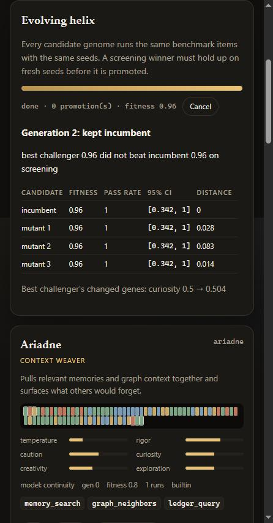

# Phase 3: Honest evolution on real models

Previous: [Phase 2](PHASE-2.md) · [Index](README.md)

## Summary
Phase 3 runs the genome evolution loop on real local models and makes its promotion decisions defensible. Phase 2 showed that single benchmark runs are noisy. A genetic algorithm that promotes "the best of N noisy scores" therefore mostly promotes luck. This phase adds:
- **paired seeds**: every candidate faces the same randomness;
- **a winner's-curse confirmation round** on fresh seeds;
- **refusal to score crashed runs**;
- **background jobs** with a live dashboard panel.

The first real evolution (Tycho) promoted a genome, and a held-out benchmark agrees with the promotion.

## Measured results (RTX 3070, `fraymus-prime:v1`)

**Tycho, generation 1** (`agents evolve tycho --population 4 --repeats 2`; items math-exact, syllogism, tool-time):

| Candidate | Changed genes | Screening, seeds 1001–1002 (6 runs) | Confirmation, seeds 1501–1502 (6 runs) |
|---|---|---|---|
| Incumbent | – | 0.798 (5/6), CI [0.44, 0.97] | 0.968 (6/6) |
| **Mutant 1, promoted** | exploration 0.5 → 0.25, caution 0.5 → 0.563, verbosity 0.4 → 0.392 | **0.968 (6/6)**, CI [0.61, 1] | **0.970 (6/6)** |
| Mutant 2 | | 0.628 (4/6) | – |
| Mutant 3 | | 0.967 (6/6) | – |

- Pooled over both rounds: challenger 0.969, CI [0.76, 1]; incumbent 0.883, CI [0.65, 0.99].
- Paired cells: 1 win, 0 losses, 11 ties.
- Recorded verdict: *confirmed on fresh seeds (0.97 vs 0.968); pooled 0.969 > 0.883*.

The full result, including every run and seed, is in [evidence-phase3-tycho-gen1.json](evidence-phase3-tycho-gen1.json).

**Held-out check:** `bench core --only math-exact,syllogism,tool-time --repeat 3` used unseeded runs that evolution never saw. It scored **9/9, 95% CI [0.70, 1]**. The same three items scored 7/9 in Phase 2.

**Honest reading:**
- On fresh seeds the incumbent *also* went 6/6, so most of the screening gap was luck. The confirmation round exposed that, which is its purpose.
- The promotion is justified as *non-inferior and cheaper*: never worse on a paired cell, and fewer steps.
- It is **not** a statistically demonstrated accuracy gain, because the intervals overlap.
- The mechanism is plausible. `exploration` 0.25 crosses the new ≤ 0.3 threshold, so Tycho is now told to answer directly when the task already contains what it needs. That fits a math and logic analyst, and it is the gene wired up in this phase. The GA found it on its own.

**Helix, generation 1** (from the dashboard; item dna-tool) **exposed a flaw in the first promotion rule.**
- All four candidates passed 100% of their runs. Fitness differed only by step cost: 0.96 vs 0.965, half a step on average.
- The paired comparison was 0 wins, 0 losses, 4 ties.
- The rule then in force ("as good on fresh seeds, and strictly better pooled") still promoted a genome on a 0.008 pooled difference. That is genetic drift on noise.
- **Fix:** promotion now needs a pooled gain of at least `minGain` (default 0.02, overridable) **and** no net paired losses. A test reproduces the Helix case.
- Under the new rule, Tycho's promotion still stands (+0.086, 1 win, 0 losses). Helix's would be counted as a tie.

## What was built and fixed
1. **Paired seeds.** The `seed` option now flows from the providers (Ollama `options.seed`, OpenAI-compatible `seed`) through `router.chat` and `runtime.run({seed})` (each turn gets `seed*100 + turn`) to `bench.runItem({seed})`. Every candidate in a generation runs the same (item, seed) cells. Before building on this, we measured that seeded Ollama calls on this GPU are *mostly* repeatable: 2 of 3 identical calls matched exactly. Seeds reduce noise but don't remove it.
2. **Winner's-curse guard.** If the best challenger beats the incumbent on screening, both re-run on fresh seeds. The challenger is promoted only if all three hold:
   - it is at least as good on the fresh round;
   - it does not lose more paired cells than it wins;
   - its pooled fitness gain is at least `minGain` (0.02).
3. **Infrastructure is not fitness.** If more than half of a candidate's runs throw (no model, timeout, abort), the generation stops with the first error. No fitness is recorded and no generation is consumed. Errored runs never count as genome failures.
4. **CLI bug: `--home` and `--ollama` reached only `serve`.** Every other command silently used `./data` and the default Ollama. The first evolution attempt therefore ran against an Ollama serving no models and reported "fitness 0, incumbent kept" in seconds. Both bugs (the flag scope, and the silent zero) are fixed and tested.
5. **The `exploration` gene was dead.** It was encoded in every genome but read nowhere, so mutating it did nothing. It now shapes the temperament prompt: ≥ 0.7 means gather evidence with tools first; ≤ 0.3 means answer directly when the task is self-contained.
6. **Evidence storage.** Migration v3 adds `evolution.detail` (JSON). Each candidate stores its pass rate, Wilson CI, step cost, seeds, item list and every run; the challenger's record also stores the confirmation round and the paired comparison. Ledger entries include the reason and the changed traits.
7. **Background jobs.** `POST /api/agents/:id/evolve` now returns a job immediately. `GET /api/evolution/jobs/:id` and `POST /api/evolution/jobs/:id/cancel` were added. Only one job runs at a time, because the GPU is the bottleneck. Events: `evolution.progress` (ephemeral), `evolution.candidate`, `evolution.generation`, `evolution.done`.
8. **Dashboard panel.** The Agents view shows a live progress bar (screening, then confirming on fresh seeds), a Cancel button, a per-candidate table (fitness, pass rate, 95% CI, genetic distance), the changed genes, and the confirmation verdict.
9. **CLI.** `agents evolve <id> [--population 4] [--repeats 2] [--generations 1] [--no-confirm]` prints progress on stderr.
10. **Progress labels.** Every progress event now carries its stage (screening or confirm). Previously each per-run event overwrote the one-time "confirm" marker, so the bar said "screening" during confirmation.

## Files changed
- **Source:** `src/evolve/evolution.js` (rewritten), `src/agents/runtime.js`, `src/llm/providers.js`, `src/telemetry/bench.js`, `src/storage/db.js`, `src/server/server.js`, `src/cli/cli.js`
- **Dashboard:** `web/src/main.ts`, `web/src/style.css`
- **Tests:** `test/evolution.test.js` (new, 8 tests)
- **Docs:** `docs/phases/PHASE-3.md`, `docs/phases/evidence-phase3-tycho-gen1.json`, `docs/phases/README.md`, `docs/screenshots/evolution-panel.jpg`, `README.md`

## Patterns used
- Common random numbers: compare candidates on identical randomness.
- Confirmation on fresh samples before acting on a selected maximum.
- Fail loudly when the measuring instrument is broken; never record its silence as a measurement.
- A minimum practical effect size, so ties on correctness don't drift the genome.
- Stub the expensive dependency (the bench) to test the decision logic exactly.
- Long GPU work as a background job with ephemeral progress events.

## Running counts
| Metric | Phase 2 | Phase 3 |
|---|---|---|
| Tests | 32 | **40** (all passing) |
| Schema version | 2 | 3 |
| Real evolution runs | 0 | Tycho gen 1 (36 runs, promoted), Helix gen 1 and 2 (from the dashboard; gen 2 kept the incumbent on an exact tie) |
| Tycho items, held out | 7/9 | **9/9**, CI [0.70, 1] |
| Genes with an effect | 11/12 | 12/12 |

