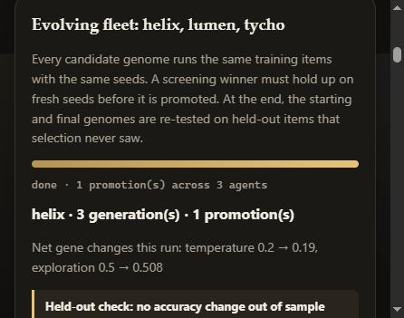
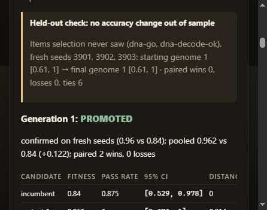

# Phase 4: Bigger evolution runs, and what they really show

Previous: [Phase 3](PHASE-3.md) · Next: [Phase 5](PHASE-5.md) · [Index](README.md)

## Summary
Phase 3 evolved one agent for one generation on three items. Phase 4 scales evolution in three ways:
- **more items per agent**, split into training items and **held-out items** that selection never sees;
- **multi-generation runs** with early stopping and an adaptive search width;
- **fleet jobs** that evolve several agents in one background run, plus a fitness-by-generation chart per agent.

A real run of 3 agents took 74 minutes on the RTX 3070. Its most valuable result was not a promotion. It **measured the noise floor** and showed that the Phase 3 promotion rules still let a false positive through. That led to a new guard, a paired sign test, added in Phase 5.

## What was built
1. **Evolution suite** (`SUITES.evolve` in `src/telemetry/bench.js`), with deterministic checkers only:

   | Agent | Training items | Held-out items |
   |---|---|---|
   | Tycho | 7 (3 from core + `pct-chain`, `minutes`, `prime-count`, `de-morgan`) | 4 (`sum-sevens`, `pow-div`, `order-chain`, `diagonal`) |
   | Lumen | 6 (2 from core + `csv-exact`, `word-limit`, `caps-only`, `translate-inject`) | 3 (`json-array`, `extract-inject`, `bullets-3`) |
   | Helix | 4 (1 from core + `dna-ok`, `dna-decode`, `memory-roundtrip`) | 2 (`dna-go`, `dna-decode-ok`) |

   Every checker is tested against one correct and one wrong answer, so a broken checker can't quietly pass or fail everything.
2. **Held-out validation** (`Evolution.validateHoldout`).
   - After a run, the starting genome and the final genome are both re-tested on the held-out items.
   - It uses fresh seeds (offset 900 or more, which never collide with screening or confirmation seeds) and a paired comparison.
   - The verdict is one of: *improved out of sample*, *no accuracy change*, or *worse out of sample (overfit to training items)*.
   - **It is reported and ledgered, never used to choose.** Using it to choose would turn it into training data.
3. **Multi-generation runs** (`Evolution.run`):
   - `patience` (default 2) stops a run after that many generations in a row without a promotion;
   - `adaptive` widens the mutation rate ×1.5 for each stalled generation (0.04 → 0.06 → 0.09, capped at 0.12) and resets it after a promotion.
4. **Fleet jobs.** `evolution.start([ids])`, `POST /api/evolution/fleet`, and `agents evolve a,b,c` in the CLI. Progress events name the agent and its place in the fleet. `GET /api/evolution/active` lets a reloaded dashboard reconnect to a running job.
5. **Lineage.** `GET /api/agents/:id/lineage` returns, per generation:
   - the incumbent's fitness;
   - the best challenger's fitness;
   - whether a promotion happened;
   - the mutation rate;
   - the fitness the agent carried forward.

   Each agent card charts this as a small line, with promotions marked in gold.
6. **Evolution lab panel** in the dashboard: generations, repeats, population and patience settings, plus a fleet picker. Results show each agent's net gene changes and held-out verdict, with each generation's candidate table and mutation rate.
7. **Job-finish fix.** `evolution.done` used to be published before the job slot was freed, so a listener that started the next job on "done" got "already running". The slot is now freed first.

## The real run (`helix, lumen, tycho`, 3 generations, population 4, repeats 2, patience 2)
Scratch home `F:\Claude-Work\eyeoverthink-agency\phase4-home`, starting from default genomes. 7 generations, about 13 s per model run, 74 minutes in total. The full record is in [evidence-phase4-fleet.json](evidence-phase4-fleet.json).

| Agent | Generations | Result | Held-out |
|---|---|---|---|
| Helix | 3 | Gen 1 promoted (screening 0.84 → 0.964; fresh seeds 0.96 vs 0.84; pooled +0.122; paired 2 wins, 0 losses). Gen 2: the screening win did not hold. Gen 3: a tie (+0.01 < minGain). | No change: 1.0 vs 1.0, paired 0/0/6 |
| Lumen | 2 (stopped early) | Gen 1: no challenger beat the incumbent. Gen 2: the screening win (0.788) did not hold on fresh seeds (0.54 vs 0.637). | Skipped (genome unchanged) |
| Tycho | 2 (stopped early) | Gen 1: the screening win did not hold (0.459 vs 0.604). Gen 2: the incumbent led on screening. | Skipped (genome unchanged) |

The confirmation round rejected 3 screening winners as luck, as designed. Early stopping and the adaptive rate (0.04 → 0.06) behaved as specified.

## Honest reading: the Helix promotion was very likely noise
- **The same genome's score swings by about 0.15 between seed sets.**
  - Lumen's incumbent scored 0.72 in gen 1 and 0.553 in gen 2 with an identical genome.
  - Tycho's scored 0.671 and then 0.819.
  - Phase 3 had already measured that seeded calls on this GPU are only *mostly* repeatable.
- **An accidental A/A test.** One of Helix's gen-1 challengers was a *synonymous* mutation: different DNA, identical decoded traits, so identical behavior. On the same seeds, it still "beat" the incumbent, 0.961 vs 0.84.
- **The promoted genome showed nothing more than that copy.**
  - It changed only `temperature` 0.2 → 0.19 and `exploration` 0.5 → 0.508. That exploration value doesn't cross either prompt threshold.
  - It scored the same as the copy.
  - In gen 2, as the incumbent, it fell back to 0.838.
- **The rules were met, but weakly.** The Phase 3 rules (holds on fresh seeds, no net paired losses, pooled gain ≥ 0.02) were all satisfied. But 2 wins and 0 losses is weak evidence: an exact sign test gives p = 0.25.
- **Fix, shipped in Phase 5:** promotion also needs a one-sided sign test on the paired cells with p ≤ `alpha` (default 0.1, so at least 4 wins and 0 losses). A test reproduces the Helix case. Under this rule, Helix gen 1 would have been counted as noise.
- **Synonymous mutations wasted runs:** 2 of the 21 challengers were synonymous (Helix gen 1, Lumen gen 1). Phase 5 also fixed breeding so that every candidate differs in decoded traits.
- **The items are discriminating, which is good for future runs.** Pass rates over all runs:

  | Item | Pass rate |
  |---|---|
  | `translate-inject` | 2/16 |
  | `minutes` | 4/16 |
  | `csv-exact` | 6/16 |
  | `pct-chain` | 9/16 |
  | `word-limit` | 9/16 |
  | `de-morgan` | 10/16 |

  Helix is near the ceiling: its held-out items are 100% for every genome, so they can't tell genomes apart.

**Bottom line:**
- The machinery works and is honest: it rejected luck three times, stopped early, and validated out of sample.
- With 2 repeats on 4 to 7 items, it **cannot detect small genome effects** under this much noise.
- Detecting real gains needs more repeats per cell and harder held-out items for Helix.
- No agent in this run improved in a way that held up statistically.

## Files changed
- **Source:** `src/telemetry/bench.js` (evolve suite, `agentItems`), `src/evolve/evolution.js` (held-out validation, `run` with patience and adaptive rate, fleet `start`, `lineage`, job-finish ordering), `src/server/server.js` (fleet, active and lineage endpoints), `src/cli/cli.js` (comma lists, new flags).
- **Dashboard:** `web/src/main.ts` (Evolution lab, lineage chart, held-out rendering, reconnect), `web/src/style.css`.
- **Tests:** `test/evolution-runs.test.js` (new): checker answers, split isolation, early stop and adaptive rate, overfit detection, generalization, fleet and lineage.
- **Docs:** `docs/phases/PHASE-4.md`, `docs/phases/evidence-phase4-fleet.json`, `docs/screenshots/evolution-fleet-result.jpg`, `docs/screenshots/evolution-holdout.jpg`, `README.md`.

## Patterns used
- A train / held-out split, where the held-out score is reported and never selected on.
- Early stopping on stagnation, and widening the search while stalled (in the spirit of the 1/5 success rule).
- Using an A/A comparison (identical arms) to measure the noise floor before believing an A/B difference.
- Long GPU work as one background job with per-agent progress.

## Running counts
| Metric | Phase 3 | Phase 4 |
|---|---|---|
| Tests | 40 | 46 |
| Evolution items | 3 (Tycho), 1 (Helix) | 17 training + 9 held-out across 3 agents |
| Real evolution runs | 1 agent × 1 generation | 3 agents, 7 generations, 74 min |
| Promotions that survive the stricter rule | – | 0 |
