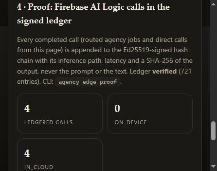
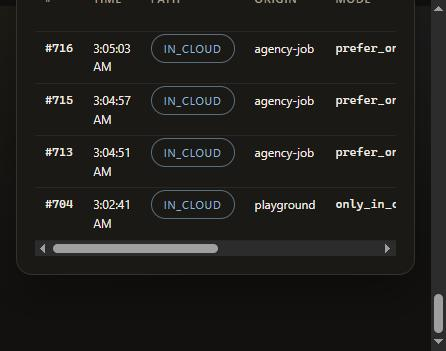
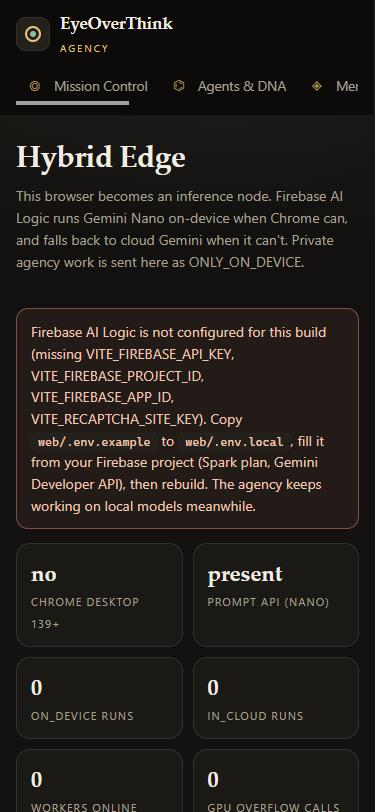

# Phase 5: Firebase edge live: real AI Logic calls, GPU overflow, signed proof

Previous: [Phase 4](PHASE-4.md) · Next: [Phase 6](PHASE-6.md) · [Index](README.md)

## Summary
The contest requires Firebase AI Logic to be called at runtime. The edge tier existed since Phase 1, but a review for this phase found three problems that would have made that requirement weak or blocked it outright:

1. **Firebase was almost never called.** While Ollama is up, the router only reached the edge tier after every local model had failed. In normal use, Firebase AI Logic would sit idle.
2. **Nothing proved a call happened.** Completed edge jobs left no durable record.
3. **The first call would likely have failed.** The App Check debug token was switched on only under the Vite dev server (`import.meta.env.DEV`). The dashboard the agency actually serves is the production build, so on localhost App Check would have rejected every call.

This phase fixes all three, adds a setup doctor, and then **proves it against the real Firebase project `eyeoverthink-agency`**: direct calls from the dashboard, and **GPU-overflow calls made by a running mission**, all signed into the ledger. Real calls exposed two more bugs that simulated tests could not (see below). Phase 4's evidence also motivated a statistical guard on evolution, which ships here.

## What was built
1. **GPU overflow routing** (`src/llm/router.js`, `edge.overflow` in `src/core/config.js`).
   - The local GPU runs one generation at a time (an 8 GB card).
   - While it is busy and a dashboard tab is serving as an edge worker, a `fast`, `plan`, `critic` or `reason` call goes to Firebase AI Logic instead of waiting in the GPU queue. This is real extra capacity, not a demo path.
   - **Guards:**
     - Calls with a seed (benchmarks, evolution) never overflow, so paired comparisons stay on one model.
     - Calls that name an explicit model never overflow.
     - Private calls overflow only to a worker that can run Gemini Nano, and they are pinned to `ONLY_ON_DEVICE`.
   - `router.usage.edgeOverflow` counts overflow calls, and each one publishes a `router.overflow` event.
2. **Ledgered proof of every Firebase call** (`EdgeHub.attest`, `src/llm/edge.js`).
   - Each completed call is appended to the Ed25519-signed hash chain as `edge.inference`. The entry records:
     - origin (`agency-job` or `playground`);
     - mode;
     - `ON_DEVICE` or `IN_CLOUD`;
     - latency and output size;
     - the Firebase project and cloud model;
     - a SHA-256 of the output.
   - **The prompt and the output text are never stored**, so private jobs can't leak into the ledger.
   - Direct calls from the Hybrid Edge page report their metadata through `POST /api/edge/attest`, which sanitizes every field.
   - `GET /api/edge/proof` and `agency edge proof` list the entries, and the proof endpoint re-verifies the whole chain.
3. **Edge doctor** (`src/llm/edge-doctor.js`; `agency edge doctor`; `GET /api/edge/doctor`; step 0 on the Hybrid Edge page). It runs offline and masks every secret. It checks:
   - that the env file exists;
   - required keys and placeholders;
   - the format of the API key, project ID, app ID and reCAPTCHA key;
   - that the auth domain matches the project;
   - the App Check provider;
   - debug mode;
   - that the env file is **git-ignored and not tracked**;
   - that `web/dist` was built **after** `.env.local` last changed and actually contains the project ID. Vite bakes the config into the bundle at build time, so a stale build serves stale config.
4. **App Check debug on localhost for the production build.**
   - It is now enabled when `VITE_APPCHECK_DEBUG=true` and the page is on `localhost`, `127.0.0.1` or `[::1]`, not only under the Vite dev server.
   - The token still works only after you safelist it in the Firebase console.
5. **First-call error translation** (`explainFirebaseError`). App Check rejection, a bad API key, AI Logic not enabled, and Nano being unavailable are each mapped to their fix. This applies both on the page and in the worker's error state.
6. **Workers report their identity.** Each worker sends its public Firebase project ID and cloud model (no keys), and these go into each ledger entry.
7. **Hybrid Edge page:**
   - step 0, the setup checklist;
   - an explanation of overflow in step 2;
   - a "GPU overflow calls" counter;
   - step 4, the proof table with ledger verification.
8. **Setup guide:** [docs/FIREBASE_SETUP.md](../FIREBASE_SETUP.md), covering project, AI Logic, web app, App Check, env file, doctor, build, first call and proof.

## Live proof on the real Firebase project
Main server, scratch home `phase4-home`, built dashboard on `localhost:8790`, Firebase project `eyeoverthink-agency` (Spark, Gemini Developer API, App Check with reCAPTCHA v3 and a registered debug token).

| Ledger | Origin | Mode | Path | Latency | Output |
|---|---|---|---|---|---|
| #704 | playground | only_in_cloud | IN_CLOUD | 12.2 s (first call, cold) | 6 chars ("Ready.") |
| #713 | **agency-job (GPU overflow)** | prefer_on_device | IN_CLOUD | 7.0 s | 2,008 chars |
| #715 | **agency-job (GPU overflow)** | prefer_on_device | IN_CLOUD | 5.7 s | 2,047 chars |
| #716 | **agency-job (GPU overflow)** | prefer_on_device | IN_CLOUD | 5.9 s | 3,210 chars |

- The mission ("compare three food-waste strategies for a bakery") completed. It made 160 model calls; while the GPU was busy, **3 went through Firebase AI Logic** and the rest ran locally. The ledger re-verified end to end at 721 entries.
- `prefer_on_device` ran `IN_CLOUD` because Gemini Nano is `unavailable` in this browser. That is the hybrid fallback working as designed. ON_DEVICE needs a Chrome with Nano available.
- An earlier test ran on a scratch home on port 8791: #19 (logged `UNKNOWN`, see bug 1), then #21 `only_in_cloud` (4.7 s) and #22 `prefer_on_device` (falls back to `IN_CLOUD`, 4.7 s).

### Failures on the way to the first call, in order (each now handled by the doctor, the error helper, or the guide)
1. **AI Logic was not turned on:** `AI/api-not-enabled`. The error helper did not match this code at first; it now does.
2. **Unregistered debug token:** App Check returned 403, then, once the token was registered, the 403 went away.
3. **`403 Caller does not have required permission … serviceUsageConsumer`, right after turning on AI Logic.** Isolated by sending the same request with and without headers: plain API key 200, `x-firebase-appid` with no token 401, with the browser's App Check token 403. It cleared on its own a few minutes later, so the cause was permissions still spreading.
4. **Debug tokens are per origin:** `localhost:8790` needed its own token. Until it was registered, the first mission's 8 overflow calls failed with 401 and **each fell back to the local GPU**; the mission still completed. The circuit breaker paused overflow after repeated failures.

### Bugs only real calls could reveal (fixed)
1. **The SDK's `InferenceSource` values are lower case** (`'in_cloud'`, `'on_device'`). The code expected upper case, so every real call would have been recorded as `UNKNOWN` (#19). The simulated-worker tests had used the values I assumed. The browser and server now accept either case, and a test uses the SDK's real values.
2. **"Prompt API present" is not "Nano available."** `LanguageModel` existed while `availability()` was `unavailable`. The page and worker now report real availability, and private overflow goes only to workers whose Nano is `available` (`downloadable` doesn't count).
3. The page re-render after an attestation wiped the answer. The last result is now kept and shown with its ledger number.

## Evolution guard: paired sign test (from Phase 4's evidence)
In [Phase 4](PHASE-4.md), a behaviorally identical copy of Helix's incumbent "beat" it 0.961 vs 0.84 on the same seeds, and the promoted genome fell back next generation. Its record was 2 wins, 0 losses, which looks clean but is weak evidence. Promotion now also requires an exact one-sided **sign test** on the discordant paired cells, with p ≤ `alpha` (default 0.1, so at least 4 wins and 0 losses). This applies to the API (`alpha`) and the CLI (`--alpha`). Ties carry no information, so efficiency-only promotions are still governed by `minGain`. A test reproduces the Helix case (p = 0.25, not promoted) and checks exact p-values.

## Evolution fix found while testing (synonymous mutations)
A Phase 3 test failed about 1 run in 6. The cause was a real bug, not the test.
- A point mutation in the low bits of a gene can decode to **the same trait values**. That happens because `maxSteps`, `reflection` and `memoryDepth` are whole numbers, and other traits are quantized. Biology calls this a synonymous mutation.
- Such a "challenger" behaves exactly like the incumbent. Evaluating it wastes GPU runs, and promoting it is pure noise.
- **Fix:** breeding now requires every candidate in a generation to be distinct in decoded traits, not just in DNA sequence.
- A new test breeds 8 generations at a low mutation rate and checks that no two candidates in any generation behave identically. The once-flaky test passed 12 of 12 reruns.
- The Phase 4 fleet run had already started on the old code; [Phase 4](PHASE-4.md) reports how many of its candidates were synonymous.

## Verification
- **Tests:** 53 of 53 pass, including the new sign-test test. Of these, 5 are new edge tests:
  - dotenv parsing and masking;
  - the doctor's checks: missing file, placeholders, malformed IDs (masked in the report), a stale build, a build without the project, and the ready state;
  - this repo can never commit `web/.env.local`;
  - GPU overflow routing end to end, with a simulated browser worker answering a routed job, covering all six guards and the ledger entry, and checking that the prompt and text are absent;
  - attestation sanitization.
- **Dashboard:**
  - checked on a separate server (port 8791, scratch home, no GPU), because the main server was running the Phase 4 job;
  - step 0 shows the real doctor result for this repo, which has no `.env.local` yet;
  - step 4 rendered a test attestation (project `verification-only`) with the ledger re-verified at 17 entries;
  - the buttons stay disabled until the build is configured.
- **CLI:** before the user's config, `agency edge doctor` printed `FAIL web/.env.local does not exist` and exited with code 4. On the real config it caught a real stale build. After the rebuild it reports `Edge config looks ready` and exits with code 0.

## Files changed
- **Source:**
  - `src/llm/edge-doctor.js` (new);
  - `src/llm/edge.js`;
  - `src/llm/router.js`;
  - `src/core/config.js`;
  - `src/agency.js`;
  - `src/server/server.js`;
  - `src/cli/cli.js`;
  - `src/evolve/evolution.js` (synonymous-mutation fix).
- **Dashboard:** `web/src/hybrid.ts`, `web/src/edge.ts`, `web/src/main.ts`, `web/src/style.css`.
- **Tests:** `test/edge.test.js` (new); `test/evolution-runs.test.js` (synonymous test).
- **Docs:** `docs/FIREBASE_SETUP.md` (new), `docs/phases/PHASE-5.md`, `README.md`.

## Patterns used
- **Spill-over capacity:** route to the secondary tier when the primary is saturated, not only when it fails.
- **Attest metadata, hash the content:** the ledger proves *that* a call ran and *which* output existed, without storing private text.
- **Check the build, not just the source:** build-time config makes "the file is right" and "the app is right" two different facts.
- **Compare by phenotype, not genotype,** when the encoding has redundancy.

## Remaining
- **ON_DEVICE** (Gemini Nano) is unproven: it needs a Chrome where `LanguageModel.availability()` reports `available`.
- Debug tokens are for development. Before a public demo, add the real domain to the reCAPTCHA key, turn on App Check enforcement for AI Logic, and delete debug tokens you no longer use.

## Running counts
| Metric | Phase 4 | Phase 5 |
|---|---|---|
| Tests | 46 | **53** (all passing) |
| Ways Firebase AI Logic is called | fallback only | **GPU overflow**, private ON_DEVICE, fallback, direct |
| Firebase calls with signed proof | none | every call (`edge.inference`) |
| Real Firebase calls made | 0 | **7 ledgered** (4 direct, 3 by GPU overflow during a real mission) |
