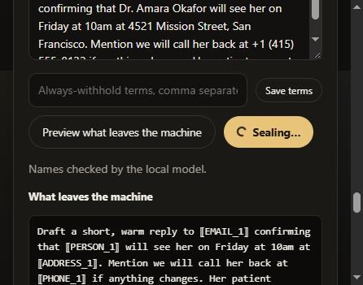
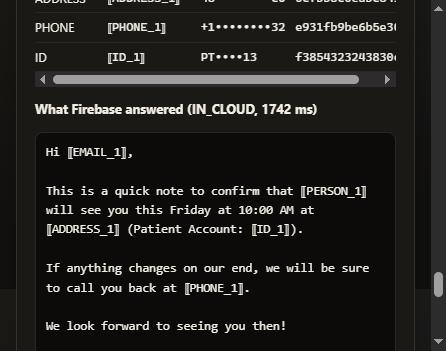
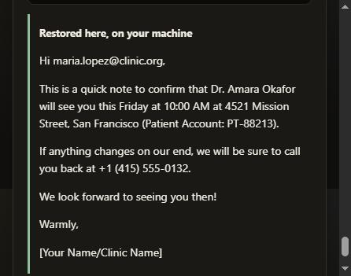

# Phase 8: Private yet hybrid; proof-carrying; the exam evolves

Previous: [Phase 7](PHASE-7.md) · [Index](README.md)

## Summary
Phase 8 adds four subsystems. Each answers a question most agent platforms don't ask:

| Question | Subsystem |
|---|---|
| Can private work use the cloud without the cloud seeing the private parts? | **Privacy Membrane** (`src/guard/membrane.js`) |
| Can anyone check how an answer was produced, without trusting the agency? | **Proof-carrying receipts** (`src/core/receipt.js`, `receipt-verify.js`, `bin/verify-receipt.js`) |
| What if the exam is the bottleneck, not the agent? | **Red Queen exams** (`src/evolve/examiner.js`) |
| Can you *see* the boundary? | **Sovereignty Map** (`web/src/map.ts`, `GET /api/sovereignty`) |

All four were run end to end on this machine: real models, and the real Firebase project for the membrane.

## 1. Privacy Membrane
A new privacy tier between `normal` and `private`: **`sealed`**. Before anything leaves the machine (Firebase edge worker, cloud API, Ollama `-cloud` model), the membrane:
1. **Detects** sensitive spans:
   - deterministic patterns: email, phone, Luhn-checked card, SSN, IBAN, IP, keys and JWTs, passwords, token URLs, and owner terms;
   - structure patterns: honorific names, street addresses, account-style IDs;
   - a **local** model, pinned to `privacy: private`, for names, organizations, addresses and medical details. Only spans that literally occur in the text are accepted, so the model can't invent what to hide.
2. **Seals** each value with a consistent placeholder (`⟦PERSON_1⟧`) and tells the model to keep placeholders intact.
3. **Audits** the exact outbound payload, also catching digits that leak without their separators or without a country code. **Any leak blocks the call.**
4. **Restores** the reply locally. Restoring tolerates mangled brackets and keeps JSON valid.
5. **Ledgers** a `membrane.crossing` entry with counts per type and keyed HMAC tags, never values.

**It fails closed.** If the configured local name finder can't run, nothing crosses, and the work falls back to local models. Previews show the gap instead of hiding it.

**Two leaks found and closed while building it:**
- Network tools ignored `privacy` entirely, so a `private` agent could carry secrets out through `web_search`. Now network tools are disabled for `private` work, and blocked for `sealed` work when their arguments contain sensitive values.
- Plugin providers marked `remote` were still candidates for `private` work.

### Measured: a real sealed call through Firebase AI Logic
Input: *"Draft a short, warm reply to maria.lopez@clinic.org confirming that Dr. Amara Okafor will see her on Friday at 10am at 4521 Mission Street, San Francisco… call her back at +1 (415) 555-0132… Her patient account is PT-88213."*
- **Left the machine:** "…reply to ⟦EMAIL_1⟧ confirming that ⟦PERSON_1⟧ will see her… at ⟦ADDRESS_1⟧… ⟦PHONE_1⟧… ⟦ID_1⟧."
- **Gemini (Firebase AI Logic, `IN_CLOUD`, 1.7 s)** wrote the email and kept all five placeholders.
- **Restored locally:** "Hi maria.lopez@clinic.org… Dr. Amara Okafor will see you this Friday at 10:00 AM at 4521 Mission Street, San Francisco (Patient Account: PT-88213)… +1 (415) 555-0132."
- **Ledger #1173:** `membrane.crossing`, provider `firebase-ai-logic`, withheld `{ADDRESS:1, EMAIL:1, ID:1, PERSON:1, PHONE:1}`, audit clean, values stored as keyed tags only.

### Real-model finding: "the model ran" is not "the model found the names"
The first real preview reported name detection as `ok`, yet sealed only the email and phone. The probe showed why:
- **`llama3.2` (3B, the `fast` role):** returned `{"entities":[]}` in 0.4 s.
- **`fraymus-prime:v1` (the `reason` role):** found all five spans in 12 s.

**Fixes:**
- Name detection now uses the `reason` role by default (`membrane.nerRole`).
- New structure patterns catch honorific names, street addresses and account IDs **with no model at all**, so they form a floor that doesn't depend on any one model.
- A regression test uses the exact real text.

## 2. Proof-carrying receipts
**Issuing** (`agency receipt <missionId>`, `GET /api/missions/:id/receipt`, or **Download receipt** on a finished mission) packages:
- the mission's ledger entries (plan, tool calls, Firebase calls, membrane crossings, completion);
- a Merkle inclusion proof for each entry against **one snapshot** of the ledger;
- a root statement `{missionId, deliverableSha256, merkleRoot, size}` signed by the agency key.

To make this possible, Firebase calls and membrane crossings now record the `missionId` they served. Dashboard (playground) attestations can't claim a mission.

**Verifying:** `src/core/receipt-verify.js` has **no imports** and uses WebCrypto (Ed25519, SHA-256), so the same file runs in Node (`node bin/verify-receipt.js receipt.json deliverable.txt`) and in the browser (Ledger → *Verify a receipt*, without calling the server). It checks:
- every hash, signature and Merkle path;
- that every entry belongs to the mission, and that the completion entry matches the signed deliverable hash;
- optionally, that the text you hold matches byte for byte.

It recomputes the summary (tool calls, Firebase calls by path, values withheld) from verified entries, instead of trusting the receipt's own claims. Tests cover seven kinds of tampering: one extra byte, an inflated score, a swapped signature, a broken proof, an edited statement, a swapped key, and an entry from another mission.

### Measured: a real `sealed` mission, verified offline
Mission `ms_01m7mqrhamwp24vggbk540` (privacy `sealed`, patient details in the goal; completed with score 0.91). Its receipt holds 8 entries against a signed ledger of 1,185. `node bin/verify-receipt.js`, with no agency running, reported **VERIFIED**:
- 9/9 checks;
- 8/8 entries intact, signed and included;
- every entry bound to the mission;
- the 917-character deliverable matches byte for byte.

The verified contents were 5 tool calls and **0 Firebase calls**. That's accurate: the GPU never queued during this mission, so nothing overflowed.

## 3. Red Queen exams
Phase 6 found that many benchmark items are always passed or always failed, so they carry no signal. The examiner keeps the exam at the frontier of the agent's ability:
- **Propose:** an examiner model invents questions, each with a JavaScript program. **The model never supplies the answer.** The program runs in the permission-locked sandbox, and its single line of output becomes the answer key. Failing, ambiguous or file-touching programs are rejected.
- **Trial:** candidates run against the current genome on their own seed block (8001+). Only frontier items (some passes, some failures) are admitted, alternating between training and held-out.
- **Retire:** items the agent saturates twice in a row retire.

Evolution and A/A calibration pick up admitted items automatically. Answers go into the ledger by hash, so the exam isn't leaked (`agents exam <id>`, `POST /api/exams`, Evolution lab → *Red Queen: grow the exam*). Migration v4 adds the `exam_items` table.

### Measured: Tycho, one cycle on real models
*(filled in below from the run)*

## 4. Sovereignty Map
A live view of the boundary, drawn from real events:
- **Inside the ring is this machine:** the local GPU with its busy/queued state, the 10 agents colored by genome, the ledger counter, and the browser edge worker on the ring.
- **The ring is the membrane.**
- **Outside:** Firebase AI Logic and the web.

**What drives it:**
- **The `router.call` event** (new, ephemeral), published for every model call with `remote`, `sealed`, `overflow`, `inferenceSource` and `missionId`. Local calls pulse to the GPU, and Firebase calls travel out across the ring.
- **Other events:** `membrane.crossing` shows an "N withheld" badge on the ring; `membrane.egress_blocked` bounces off the ring in red; web tool calls cross the ring in green.
- **Totals from `GET /api/sovereignty`,** computed from the signed ledger: Firebase calls by path and by overflow, values withheld by type, egress blocked, ledger size, receipts issued, GPU state and edge workers.

## Tests
78 pass. New suites:
- `test/membrane.test.js` (11): detectors and benign text; seal/restore; the audit; local-only NER; router sealing; sealed overflow to the edge; the egress guard; fail-closed; boundary telemetry.
- `test/receipt.test.js` (5).
- `test/examiner.test.js` (4).

## Files
- **New:** `src/guard/membrane.js`, `src/core/receipt.js`, `src/core/receipt-verify.js`, `bin/verify-receipt.js`, `src/evolve/examiner.js`, `web/src/map.ts`, three test files.
- **Changed:**
  - `src/llm/router.js` (sealing, `isRemote`, telemetry, private excludes remote plugins);
  - `src/tools/registry.js` and `builtin.js` (egress guard, `egress` flags);
  - `src/agency.js`;
  - `src/server/server.js` (membrane, receipt, exam and sovereignty endpoints);
  - `src/cli/cli.js`;
  - `src/orchestrator/missions.js` (sealed missions, `missionId` on model calls);
  - `src/agents/runtime.js`, `src/llm/edge.js`, `src/storage/db.js` (v4);
  - `web/src/main.ts`, `web/src/style.css`.

## Patterns used
- **Seal, audit, restore:** a reversible transformation at a trust boundary, with an exact-payload audit that blocks on failure.
- **Fail closed** when a safety component degrades; report the degradation instead of hiding it.
- **Proof-carrying data:** a hash chain, Merkle inclusion and a signed root, verifiable with zero dependencies.
- **Creativity from the model, truth from execution:** questions come from an LLM, answers from a sandbox.
- **The visualization is driven by the same events and ledger as the system.** Nothing is staged.
