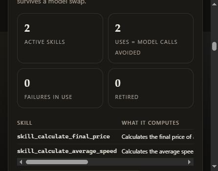

# Phase 9: Crystallization: the agency keeps what the models work out

Previous: [Phase 8](PHASE-8.md) · [Index](README.md)

## The problem: the t-shirt trap
Almost every AI product rents intelligence by the call. The model does the thinking, the product is the print on the shirt, and nothing the model works out is kept:
- tomorrow the same problem costs the same model call;
- if you swap the model, the product is no more capable than before.

The product never improves; only the model vendor's does.

## The idea: the model teaches, the system keeps
**Crystallization** turns a solved task into a **skill**: a pure function the agency owns, verifies, signs and can run without any model. Capability then accumulates in the agency instead of being rented each time:
- **Extract:** after a well-scored mission (automatic, one at a time; `crystallize.auto`, `minScore` 0.85), the `code` role distills the solution into `function main(input)` plus a description and input schema. Private missions are never mined.
- **Verify by differential testing:**
  - a different model role sees the solved task, the description and the schema, but **never the candidate's code**, and writes edge-case inputs and its own reference implementation;
  - both run in the permission-locked sandbox and must agree on every input;
  - on disagreement, a third blind implementation decides (2 of 3);
  - inputs that two of three implementations deliberately reject count as out of domain, and at least 3 in-domain inputs must agree.
- **Admit:** the skill is signed into the ledger (`skill.admit`: code hash, source mission, extractor and reference models) and registered as a tool, `skill_<name>`, that agents can call. It answers in the sandbox **with no model call**.
- **Compound:** later skills can call earlier ones (the library is injected into the sandbox), so capability builds on itself.
- **Persist:** skills are stored (migration v5) and re-registered as tools at boot, so they survive restarts and model swaps.
- **Measure:** uses, failures, and "model calls avoided" (`GET /api/skills`, `agency skills`, and the Crystallized skills panel).

## Measured on real models
| Source | Result | Notes |
|---|---|---|
| Compound discounts (12% then 8% on $120) | **Admitted** `skill_calculate_final_price` | `qwen2.5-coder` extracted it and `fraymus-prime` verified it on 6 inputs. Hand-checked: 100 × .88 × .92 = 80.96 ✓, 50 × .85 × .9 = 38.25 ✓, 200 × .8 × .95 = 152 ✓. Invoked: **97.152 in 0.3 s, zero model calls.** |
| Round-trip average speed (40 / 60 mph) | Rejected four times, then **admitted** `skill_calculate_average_speed` | Each rejection exposed a verifier flaw (below). Final code: `2·a·b/(a+b)`, the harmonic mean. Invoked: **48, zero model calls.** |
| A completed sealed mission (appointment letter) | Rejected (malformed proposal) | Nothing computational in it, so the correct outcome is no skill. |

**The four average-speed rejections, each a real verifier flaw, each fixed and tested:**
1. **The reference misread the spec.** With only a one-line description and parameter names, it returned ratios like 1.17. **Fix:** the reference also sees the *solved task*, the ground truth both should derive from (still never the candidate's code).
2. **Invalid inputs counted as disagreement.** A speed of 0 or below made the reference throw by design while the candidate returned a number. **Fix:** an input that two of three implementations reject is out of domain and reported, not counted against the candidate.
3. **The same value in a different shape.** The tie-breaker returned `{"averageSpeed": 0}` where the candidate returned `0`. **Fix:** single-key wrappers are unwrapped before comparing.
4. Nondeterminism between runs (new inputs and implementations each time) is expected; the rules above make the outcome depend on correctness, not luck.

Every fix moved the verifier toward judging *meaning*. None loosened it toward admitting more: a plausible but wrong skill (adding discounts instead of compounding them) still loses the 2-of-3 vote.

## Tests
88 pass. `test/crystallizer.test.js` (9) covers:
- output equality, including unwrapping;
- a verified skill callable as a tool **with no model call**;
- the reference seeing the task but never the code;
- a wrong (additive) skill losing the 2-of-3 vote;
- a buggy reference outvoted on the tie-break;
- **skills composing** (`skill_cart_total` calls `skill_compound_discount`);
- refusals: nothing reusable, malformed, duplicate;
- persistence across a restart;
- out-of-domain inputs;
- **automatic crystallization after a well-scored mission**, with provenance pointing at it, and private missions never mined.

## Files
- **New:** `src/evolve/crystallizer.js`, `test/crystallizer.test.js`.
- **Changed:**
  - `src/storage/db.js` (v5 `skills`);
  - `src/agency.js` (automatic crystallization queue, loading skills at boot);
  - `src/server/server.js` (`/api/skills`, crystallize, invoke, retire);
  - `src/cli/cli.js` (`skills`, `skills crystallize`, `skills run`);
  - `web/src/main.ts` (Crystallized skills panel);
  - `test/helpers.js` (auto off in tests).

## Patterns used
- **Distillation into owned artifacts:** model reasoning becomes verified code the system keeps.
- **Differential testing with N-version majority:** independent implementations, the solved task as shared ground truth, and the code kept blind.
- **Agreement on meaning, not form:** a domain rule for inputs, and unwrapping for output shape.
- **Composition for compounding:** skills call skills.
- **Provenance in the ledger:** every skill traces to the mission and models it came from.

## What this enables next
- Agents preferring a matching skill over a model call (routing by skill description).
- Retiring skills that fail in use.
- Carrying skills between agencies inside organism plasmids (the DNA layer already moves agents this way).
- A "model calls avoided over time" curve as the agency's headline metric.
