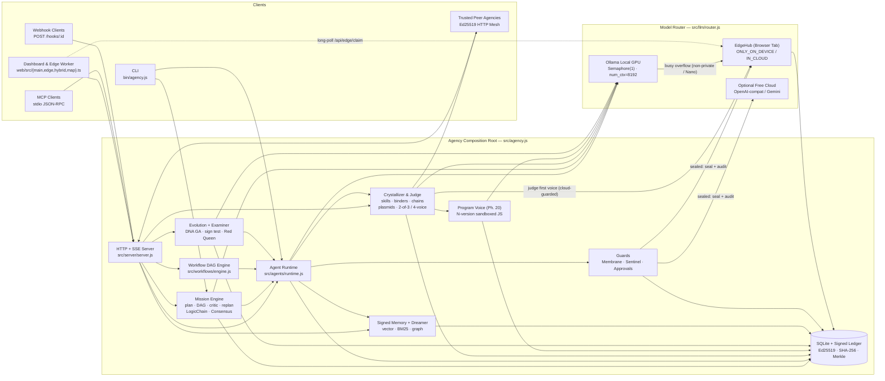

# Architecture Map — `eyeoverthink-agency` (`phase-20-program-judge`)

> Synthesized from direct source inspection of `phase-20-program-judge` (zero external runtime dependencies in `src/` — Node.js ≥ 22.13 built-ins `node:sqlite`, `node:crypto`, `node:http`, `node:child_process`; `web/` uses Vite + TypeScript + Firebase AI Logic SDK).

---

## 1. System Overview & Data Flow

### Inference Tiers & Sovereignty Boundaries (`src/llm/router.js`, `src/guard/membrane.js`)
- **Local GPU Gate**: `ModelRouter.gpu = new Semaphore(1)` serializes local Ollama generations (`num_ctx: 8192`) on the 8 GB RTX 3070; per-`(provider:model)` `CircuitBreaker` (3 failures → 60 s open → half-open).
- **`privacy: "private"`**: Strictly local Ollama or `edge:only_on_device` (`InferenceMode.ONLY_ON_DEVICE` Chrome Gemini Nano when available); network tools (`web_search`, `http_get`, `http_post`) hard-blocked (`membrane.egress_blocked`); never enters `skill_examples`, `skill_gaps`, or cloud judging.
- **`privacy: "sealed"`**: Intercepted before any remote/edge/cloud call by `Membrane.sealMessages()` — 15 deterministic detectors + owner terms + local-only NER (`role: 'reason', privacy: 'private'`) replace values with `⟦TYPE_N⟧`, hard-audit outbound JSON (`MembraneLeak` fails closed), unseal replies locally, and sign `membrane.crossing` (counts + keyed HMAC tags, never raw values).
- **GPU Overflow & Cloud Judge**: Busy local GPU overflows non-seeded `fast|plan|critic|reason` calls to `EdgeHub` (`prefer_on_device`); `Agency.geminiAnswer()` checks `detect(task)` (`judge.cloud_refused`) + daily cap (`200`) and rejects any non-`edge/*` fallback. Every edge call is signed into the ledger as `edge.inference` (output SHA-256 only).

---

## 2. Module Map

| Layer | Files | Key Exports / Responsibilities | SQLite Tables / Key Ledger Events |
|---|---|---|---|
| **Composition & CLI** | `src/agency.js`, `bin/agency.js`, `src/cli/cli.js`, `src/server/server.js` | `Agency` (`boot`, `ask`, `pickAnswerer`, `seekSkills`, `programAnswer`, `geminiAnswer`, `autonomyTick`), Bearer-auth HTTP/SSE API, static `web/dist` | `kv`; `agency.boot`, `agent.pick`, `skill.seek`, `judge.program`, `judge.cloud_refused` |
| **Trust & Storage** | `src/core/{identity,ledger,receipt,receipt-verify,dna,config,bus,util}.js`, `src/storage/db.js` | Ed25519 `Keyring`, SHA-256 hash-chained `Ledger` + Merkle proofs, zero-import WebCrypto `verifyReceipt`, Carbon-X DNA/plasmid codecs, SQLite WAL + FTS5 (migrations v1–v8) | `ledger`, `kv`, `schema_version`; `receipt.issue` |
| **Inference & Edge** | `src/llm/{router,providers,edge,edge-doctor}.js`, `web/src/{edge,hybrid}.ts` | `ModelRouter`, `OllamaProvider`, `OpenAICompatProvider`, `GeminiProvider`, `EdgeHub` (long-poll claim/result/attest), Firebase AI Logic + App Check | `edge.inference` |
| **Agents & Tools** | `src/agents/{runtime,registry,roster,forge}.js`, `src/tools/{registry,builtin}.js` | Single JSON agent loop (`AgentRuntime`: skill-first, compaction, narration/placeholder/echo guards, reflection, approval parking), 10 core agents, 17 builtin tools + `runSandboxedJs` (`--permission`, 128 MB) | `agents`; `agent.*`, `tool.call` |
| **Orchestration** | `src/orchestrator/{missions,plan,logic-chain,consensus}.js`, `src/workflows/engine.js` | `MissionEngine` (crash-resumable DAG, Solon critique, retries, Genesis replan, Lumen synthesis, Sentinel review), 8-role `LogicChain` + JEV review, Kuramoto `Consensus`, 12-type `WorkflowEngine` + `/hooks/:id` | `missions`, `tasks`, `workflows`, `workflow_runs`; `mission.*`, `logic_chain.stage`, `workflow.*` |
| **Guards** | `src/guard/{membrane,sentinel,approvals}.js` | `Membrane` + `SealSession` + `MembraneLeak`, `Sentinel` (`scanInjection`, `stripHidden`, `redactSecrets`, `wrapUntrusted`, `screenGoal`), `Approvals` (10-min single-use signed writs) | `approvals`; `membrane.crossing`, `membrane.egress_blocked`, `approval.*`, `writ.consume` |
| **Memory & Dream** | `src/memory/memory.js`, `src/dream/dreamer.js`, `src/continuity/continuity.js` | Signed hybrid recall (`0.55·vec + 0.25·BM25 + 0.1·imp + 0.1·recency + 0.15·graph`), entity graph, idle `Dreamer` consolidation + `.sig` journals, brain dump & 3-chromosome organism snapshots | `memories`, `memories_fts`, `edges`, `dreams`; `memory.write`, `dream` |
| **Skills, Judge & Evolution** | `src/evolve/{crystallizer,binder-induction,program-voice,evolution,examiner}.js`, `src/telemetry/{bench,tracer}.js` | Differential skill crystallization, zero-model binder induction, verified wording, gap learning, zero-model composition, skill plasmids, multi-voice judge, N-version `programVoice`, GA evolution (paired seeds + Bonferroni sign test + holdout), Red Queen `Examiner` | `skills`, `skill_examples`, `skill_binders`, `skill_gaps`, `skill_chains`, `evolution`, `exam_items`, `bench_runs`, `spans`; `skill.*`, `binder.*`, `judge.*`, `answer.check`, `evolution.*`, `exam.*` |
| **Protocols** | `src/protocols/{mesh,mcp,kuramoto}.js` | Signed Ed25519 HTTP `Mesh` (±300 s, single-use nonces, trust tiers, `skill.catalog`/`request`/`offer`), stdio `McpServer` & `McpClient`, signed-coupling Kuramoto clustering | `peers`, `messages`, `mesh_nonces`; `mesh.*` |

---

## 3. Core Lifecycles

### A. Mission Lifecycle (`src/orchestrator/missions.js`)
1. **Screen & Create**: `screenGoal()` checks length/destructive commands → inserts `missions` (`queued`) → ledgers `mission.create` → registers `AbortController` (45 m timeout). On boot, `resumeInterrupted()` resets interrupted `running` tasks to `pending` and resumes.
2. **Mode Branch**: `logic_chain` dispatches to 8-role relay + non-author `review()`; `consensus` runs parallel agents + `router.embed()` + `kuramotoConsensus()` + Solon merge.
3. **Plan → DAG**: Genesis (`role: 'plan'`) generates tasks → `normalizePlan()` maps agents, drops forward/self/unknown deps → `isAcyclic()` (Kahn) → persists `tasks` transactionally (`mission.plan`). Fallback: `spearhead → lumen`.
4. **Execute & Self-Heal**: `Semaphore(2)` runs ready DAG tasks in parallel. Attempt 1 enables `skillFirst`; Solon critiques against harness evidence (`#critique`). Failures retry (`skillFirst: false`, critique attached; rejected skill routes call `crystallizer.rejectRoute`). Stalled DAGs trigger Genesis replanning (`maxReplans: 2`) inheriting prior outputs. Passing tasks ≥ 0.85 write `playbook` memories.
5. **Synthesize, Review & Archive**: Lumen merges outputs (`#finish`) → `redactSecrets()` → final critique → Sentinel security review → weighted score (`0.6·final + 0.4·avgTask`) → episodic memory → `mission.complete` (auto-triggers crystallization when `score >= 0.85`). Offline receipts (`issueReceipt()`) bundle mission entries + Merkle proofs + signed root statement.

### B. Skill Lifecycle (`src/evolve/crystallizer.js`, `src/evolve/binder-induction.js`)
1. **Crystallize & Admit**: High-scoring mission or corroborated gap family → `code` extracts `function main(input)` → blind `reason` writes reference + test inputs → answer-key scoring (Phase 13) + determinism double-run + 2-of-3 `plan` tie-break → admitted to `skills` (`active`), registered as `skill_<name>` (`skill.admit`).
2. **Skill-First Route & Zero-Call Binders**: No-model `relevance()` prefilter → active `skill_binders` executes in 3 s sandbox (`bindingProblem`: grounding + all numbers used + `FORMS` + `#learnedBlock` + `novelWording`) → **0 model calls** (`skill.route`). Otherwise one `fast` bind call; hits record `'pos'` and trigger model-free `induce()` + `leaveOneOut()` + blind synthetic verification (`binder.admit`).
3. **Verified Wording, Shadow & Gaps**: Unseen positional wording (`wordingOf`) declines routing and emits `shadow` → agent loop answers → `shadowVerdict()` runs `#judge()`. Agreement teaches `'pos'`; corroborated refutation teaches `'neg'` and logs `skill_gaps` (`skill.gap`) → union-find `gapFamilies` ≥ 3 triggers `learnGap()` (`skill.gap_learned`).
4. **Composition (Phase 14)**: Multi-skill chains validated by `chainProblem()`, judged twice (`skill_chains`), then `composeChainSkill()` writes a new composite `function main(input)` with **0 model calls** (`skill.compose`) and induces its binder at birth.
5. **Plasmids, Probation & Mesh Pull (Phases 15–16)**: `exportSkill()` bundles dependencies + signed admission entries + examples + binder spec data (no binder code) into a signed plasmid. `importSkill()` re-verifies hashes/signatures/examples and runs 2× verification rows locally, landing in `status = 'probation'` until 2 local `#trialVerdict` agreements (`skill.adopt`). Unmatched normal tasks trigger `Agency.seekSkills()`: matches peer `skill.catalog` locally (task text never leaves), pulls plasmid by name, and trials it immediately.

### C. Judge & Evolution Lifecycle (`src/evolve/{crystallizer,program-voice,evolution,examiner}.js`)
- **Measured First Agent (Phase 18)**: `pickAnswerer()` picks the top local agent on `>= 2`-number tasks when beating fallback by `>= 0.15` on `judge:study` and confirmed on `judge:heldout` (Gemini excluded — judge only).
- **Voice Ranking & Second-Voice Check (Phases 17 & 19)**: `measuredAccuracy()` weights voices across `judge:study|heldout|hard|program`. Un-shadowed in-domain normal replies run `checkAnswer()` (Gemini first when online & cloud-guarded, else top local voice ≠ first agent): agree → checked; disagree → 3rd voice decides 2-of-3 (corrects reply or marks `Unverified`, conf ≤ 0.4).
- **Multi-Voice Split, Program Voice & 20b Demotion (Phase 20)**: `#judge()` applies fraction/percent equivalence (`0.675 ≈ 67.5`) and expands 3-way splits up to `maxVoices` (4). `programVoice()` runs N-version JS programs from `code` + `reason` (tie-break `plan`) in `runSandboxedJs` — requiring agreement within `1e-6` or coarser rounding (else silent; ledgers `judge.program` with task hash only). `auditWording()` demotes rare-wording positives when `>= 4` voices answer and none support the skill (`unsupported`, no gap created).
- **Evolution & Red Queen**: Phenotype-deduplicated DNA population → paired-seed screening → sequential fresh-seed confirmation (Bonferroni-corrected exact one-sided `signTest`, A/A noise calibration) → untouched held-out validation. `Examiner` proposes sandboxed 2-of-3 verified items, admitting only frontier items (`0.2 < rate < 0.8`) and retiring saturated items.

---

## 4. Top 10 Most Important Files

1. **[`src/evolve/crystallizer.js`](../../src/evolve/crystallizer.js)** (1,678 LOC) — End-to-end learning & judge engine: skill extraction/differential testing, skill-first routing, learned binders, wording audits, multi-voice `#judge` & `checkAnswer`, gap crystallization, zero-model composition, plasmids, and probation adoption.
2. **[`src/agency.js`](../../src/agency.js)** (321 LOC) — Composition root wiring every subsystem, auto-crystallization, `ask()` metering, `pickAnswerer()`, privacy-preserving `seekSkills()`, cloud-guarded `geminiAnswer()`, and `programAnswer()`.
3. **[`src/orchestrator/missions.js`](../../src/orchestrator/missions.js)** — Crash-resumable DAG orchestrator: planning, parallel execution, Solon critique, self-healing retries, Genesis replanning, Lumen synthesis, Sentinel review, and Logic Chain / Consensus dispatch.
4. **[`src/agents/runtime.js`](../../src/agents/runtime.js)** — Unified agent execution loop: skill-first short-circuit, context pack + genome temperament, deterministic compaction, hallucination guards, tool execution with approval writ parking, reflection, and post-answer shadow/check/seek hooks.
5. **[`src/llm/router.js`](../../src/llm/router.js)** — Hybrid inference control plane enforcing the 1-slot local GPU semaphore, circuit breakers, GPU overflow to Firebase AI Logic edge workers, `private`/`ONLY_ON_DEVICE` isolation, `sealed` Membrane sealing, and `AsyncLocalStorage` metering.
6. **[`src/guard/membrane.js`](../../src/guard/membrane.js)** — Sovereignty enforcement: 15 deterministic PII/secret detectors + owner terms + local-only NER, fail-closed egress audit (`MembraneLeak`), tolerant unsealing, and keyed-HMAC `membrane.crossing` attestation.
7. **[`src/core/ledger.js`](../../src/core/ledger.js)** (paired with `src/core/receipt-verify.js`) — Append-only SHA-256 hash chain + Ed25519 signatures + Merkle inclusion proofs powering offline receipt verification and the skill family tree.
8. **[`src/evolve/binder-induction.js`](../../src/evolve/binder-induction.js)** (204 LOC) — Model-free symbolic binder induction, leave-one-out poison detection, body/question block-word learning, and positional verified-wording algebra.
9. **[`src/evolve/evolution.js`](../../src/evolve/evolution.js)** (441 LOC) — Statistically rigorous DNA genome evolution with paired seeds, Bonferroni sequential fresh-seed sign tests, A/A noise calibration, and held-out checks.
10. **[`src/evolve/examiner.js`](../../src/evolve/examiner.js)** (paired with `src/evolve/program-voice.js` and `src/protocols/mesh.js`) — Sandboxed 2-of-3 programmatic truth oracles (Red Queen frontier exams and Phase 20 N-version program judging) and the signed inter-agency mesh.
